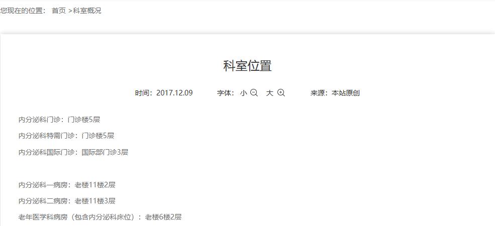
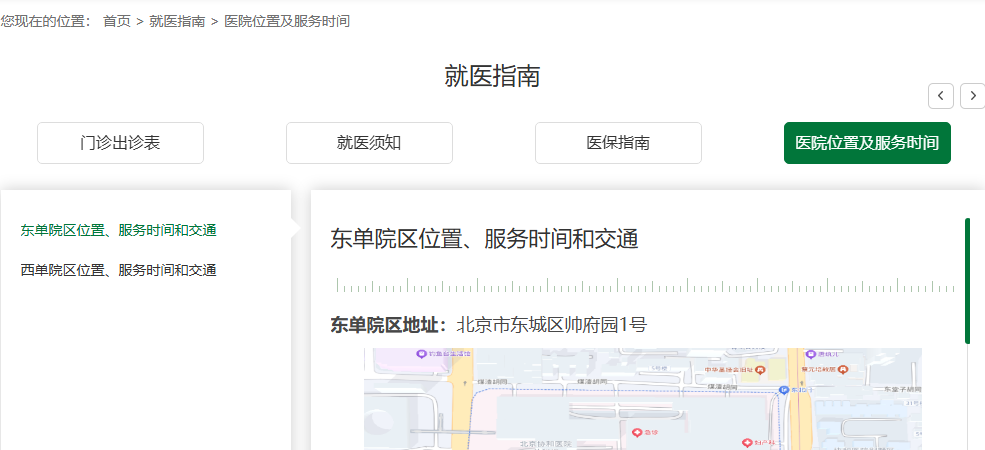
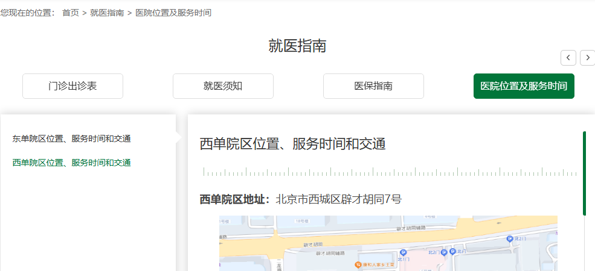
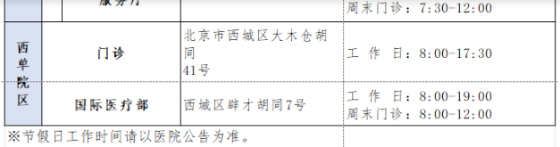
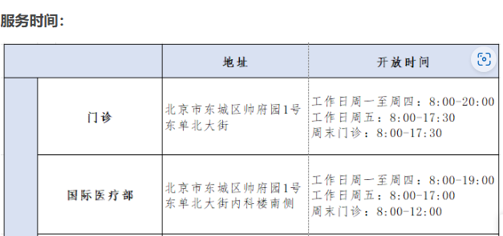

# DeepSeek Flash low 扩额：两轮 Windows M01 业务完成

## 结论

**两轮均交付了 M01 要求的完整清单，本轮业务验收通过。** 依据是模型最终回复、本轮实际浏览页面及截图、观察绑定的来源链接，以及独立读取官网公开页，不是仅凭 Runtime `succeeded` 或 Memory 笔记。

这是两个开发实例运行样本，不是正式 evaluator 评分、留出评测或组合稳定性放行。既有失败结果保留；没有把历史失败改判成功。

## 本轮实际配置

沿用 Windows 上已有 PR30 来源 URL、导航、收尾与最终 Monitor 修复候选；没有重新安装、部署或修改产品源码／默认值。每轮独立生产 Run、临时受管 Edge、Plan／Fact stores，原 M01 Goal 不变。没有给模型预填答案、官网真值或正确目标网址；外部真值仅用于运行后的业务复核。

DeepSeek 默认产品入口仍固定关闭思考。本轮启动器选择既有生产共享 `ChatCompletionsAdapter` 的 `low` profile，配合生产 `FetchDeepseekHttpClient` 和请求记录器；没有 FakeProvider、响应替换或工具别名映射。生产 summary 的 `thinkingMode=disabled` 是该注入路径下的硬编码标签，**不能作为有效模式证据**；实际 91 次 HTTP 请求全部记录 `thinking=enabled`、`reasoningEffort=low`、`maxTokens=16384`。

| 限额 | 上轮关闭思考配置 | 本轮两轮配置 |
| --- | --- | --- |
| 模型请求上限 | 100 | 200 |
| GUI 动作上限 | 100 | 200 |
| 单请求输出 tokens | 4096 | 16384 |
| Context 文本输入 tokens | 24000 | 48000 |
| Context wire 输入 tokens | 30000 | 64000 |
| 单请求期限 | 90秒 | 180秒 |
| 单轮硬期限 | 20分钟 | 30分钟 |

Planning 开启，Memory facts／lexical，Batching same-control-input-v1，Monitor guidance，recent 历史40事件；hybrid grounding、foreground、layered Guard及范围自动批准保留。source-linked finish 仍关闭，避免用仅有来源元数据的渲染结果替换完整事实清单。windowSwitch／windowHandoff 关闭。

运行前实际参数见 [第一轮配置](member-c-deepseek-low-expanded-2026-10-15/round-1-config.json) 与 [第二轮配置](member-c-deepseek-low-expanded-2026-10-15/round-2-config.json)。公开投影不含 socket、截图目录、机器路径或凭据，不是本机私有启动器。

## 两轮运行结果

| 指标 | 第一轮 | 第二轮 |
| --- | --- | --- |
| Run ID | d01-low-expanded-1792041589863-6d377ff8-3f08-4208-84cc-bd9ace33c296 | d01-low-expanded-1792041902693-f44f80e3-8cbb-4fea-bdee-9b6b213cf79d |
| 实际 HTTP 请求／HTTP200 | 49／49 | 42／42 |
| Runtime outcome／模型状态 | succeeded／success | succeeded／success |
| 业务清单 | 通过 | 通过 |
| 耗时 | 311.804秒 | 354.667秒 |
| 动作回执 | 39 completed、2 refused | 38 completed、0 refused |
| completed中 wait | 4 | 9 |
| 范围审批 | 1／1通过 | 0 |
| Runtime接纳tokens | 1196711 | 1112421 |
| 多GUI Batch | 0 | 0 |

费用未知。第二轮一次响应把结束控制与其他工具混用，生产适配器整组拒收，有限反馈重试后成功；没有部分执行或自动重放 GUI。该拒收响应的 usage 不包含在 Runtime 接纳 usage 中。两轮都曾把 `_harnessEffect` 错放到 `task_create`，本地参数校验拒收；第一轮另有缺失 scroll 坐标的拒收。第一轮两次动作拒绝分别为 `DOM_CLICK_BBOX_MISMATCH` 和 `BROWSER_CHROME_FOCUS_UNCONFIRMED`，未放宽焦点保护。

准备时一次客机 Node 路径发现脚本未找到既有入口，0模型请求／0业务动作；发现实际已安装入口后再启动上述两轮，不将准备失败算作第三个业务样本，没有安装软件。

## 逐项业务证据

- **普通／特需／国际门诊位置及日期**：两轮最终清单均交付门诊楼5层、门诊楼5层、国际部门诊3层，以及2017.12.09，来源均为 [`detail/12497.html`](https://www.pumch.cn/detail/12497.html)。第二轮 seq154 的真实截图完整显示对应原文与日期。
- **东单地址**：第二轮最终清单给出北京市东城区帅府园1号，与本轮 seq442 地址面板及独立官网读取相符。来源 [`nosocomial.html`](https://www.pumch.cn/nosocomial.html)。
- **西单地址**：第二轮最终清单给出北京市西城区辟才胡同7号，与本轮 seq291／487 西单面板相符；独立官方[西单地址文章](https://www.pumch.cn/Article/Index/detail.html?id=12980&dir_name=patient&tpl_file=register_detail)亦明确该地址。页脚另列大木仓胡同41号，不能据页脚否定面板原文。
- **第一轮地址细分不是臆造**：第一轮交付东单门诊／国际医疗部的帅府园1号东单北大街及内科楼南侧，西单门诊大木仓胡同41号、国际医疗部辟才胡同7号。seq330／381 实际截图显示官网图片表格的这些细分。第一轮文字没有把这些院区地址误当内分泌科分院设诊证据。
- **新版出诊表真实到达与精确URL**：两轮最终清单都交付 [`https://www.pumch.cn/news_visitinfo.html`](https://www.pumch.cn/news_visitinfo.html)，无此前网址拼写变体。第一轮从患者版直接选“门诊出诊表”链接，其观察绑定 href 即此新网址；第二轮实际操作为患者版 → Menu → 就医指南独立“＋” → 门诊出诊表，新页面包屑为“首页 > 就医指南 > 门诊出诊表（新）”，seq418真实截图确认落地。第二轮最终回复提供相应路径和新／旧链接区分。
- **未明确关系**：两轮都明确楼层与东单／西单院区的对应关系未明确，院区地址不证明该科室分院设诊；没有补造科室院区归属。

完整原样最终清单、生产请求模式计数、回执与指标见 [脱敏结构化报告](member-c-deepseek-low-expanded-2026-10-15.json)。报告不含隐藏推理或原始轨迹。

### 本轮来源截图（仅官网内容）

## 归因与尚存限制

- 本轮同时改变思考与多项额度，且继承已有修复；没有受控 A/B，不能说仅由 low、扩额或某一补丁导致成功。实际49／42请求未使用新增的100次请求空间；输出没有再次以 `length` 截断，但不能据此证明扩输出是必要条件。
- 没有多GUI Batch，不能据两轮耗时评价批处理提速。
- 个别导航后 observation 的截图仍是前一画面，而 DOM pageUrl 已前进。本轮业务到达采用后续稳定截图确认，不将 pageUrl 或 completed 回执单独当到达证明。未修复或宣称消除此时序风险。
- 只读诊断旧99请求失败发现，Memory被召回不等于其值完整进入模型上下文；原256-token投影软额度会省略旧事实，Plan也依赖模型更新。最后只供terminate仍返回未知工具的问题亦有历史工具消息干扰的可能，但没有因果证据。本轮未借成功结论把这些风险标成已解决，也未为此增加无必要源码修改。
- 未做 macOS 实机、正式评分、稳定性或跨窗口验收。业务完成不是安全边界、组合特性或全部产品问题的放行。

## 收尾及发布边界

两轮 Run close 均确认；专用 daemon stop退出0并正常退出。本轮临时运行器、接收器和桥收尾，Windows／PowerShell／Chrome及运行证据保留。未登录业务网站、预约、提交、支付或自动重放未知动作。

本次只向既有 PR30 发布配置投影、脱敏结果、本文、官网内容裁图和文档入口；不发布凭据、私有启动器、原轨迹／Provider exchanges、隐藏推理或操作员桌面。发布阶段只排除私人信息，不追加测试、安全／依赖／发布审查、字节校验或CI查询；不合并、不启用auto-merge。
