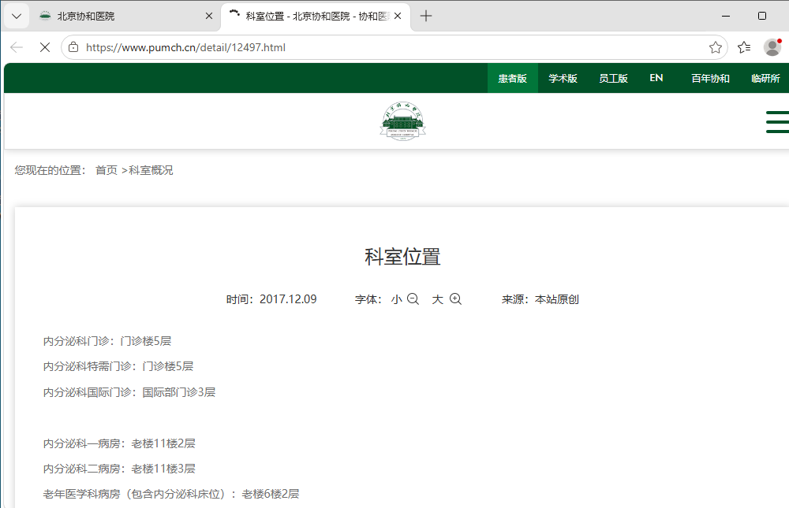

# 受管浏览器点击、UIA 可见性修复与 M01 GLM 实跑

## 合入前补修：限定 DOM 过滤的覆盖范围

组长复审确认，原 PR29 把完整网页 DOM 当作浏览器所有区域的完整依据，会误删工具栏中可见的 UIA 超链接。本轮仅把过滤限定为已证明的网页内容区；工具栏和区域不明的控件保留既有身份、坐标、禁用状态和旧引用校验。可见但未遍历的 iframe 使用已有 DOM `complete=false` 表示覆盖不足，保留既有部分覆盖回退，不新增公共协议字段或网站特例。

原有 userGesture、可见性/遮挡检查、Hyperlink 角色映射和未命名箭头规范化保留。最终三个相关文件 349/349 通过，覆盖工具栏原生点击、区域不明链接、原隐藏/歧义链接负例，以及主文档/开放 Shadow DOM 内 iframe、祖先 CSS 隐藏、离屏和部分可见边界。Sol 初审指出的 Shadow DOM 漏扫和祖先样式遗漏已修正并复核通过；覆盖判断随原有遍历执行，保留部分可见 iframe 的不完整标记。此处是离线代码合同修复，不增加 M01 模型业务样本；下方三次实跑及失败原因保持原样。Preview 不随本次源码集成切换。

## 结论

Windows 受管浏览器的点击链路修复已实机通过：隐藏轮播链接不再作为可点击 UIA 引用公开；真实左箭头能将链接带回可视区；选择可见的 Windows `Hyperlink` 引用能通过受控 DOM 路径打开科室位置详情页。

**GLM 自主业务交付仍未完成。** 完整修复后的 M01 Run 发出 33 次模型请求、执行 31 次 GUI 动作后，遇 Guard 审批请求，宿主按既定规则取消，没有最终清单。本文不把点击链路通过、派发回执或模型过程描述当作业务成功，也不提供正式评分。

配套：[结构化脱敏结果](./member-c-m01-click-repair-2026-10-13.json)、[受管点击使用边界](./getting-started.md#受管-dom-点击与新标签页)。

## 问题与修复

### DOM 点击缺少用户手势

官网“科室位置”使用 `target="_blank"`。修复前，在真实可见控件上运行生产 DOM 表达式，收到 completed，但浏览器仍只有原科室主页标签页。原 CDP `Runtime.evaluate` 没有授予用户手势。

`managed-browser-host.ts` 仅对实际点击请求设置 `userGesture`。候选收集、原生点击验证和输入焦点验证不授予手势。后续观察仍只接受已绑定受管窗口内的唯一活动标签页，新窗口不自动接管。

### 隐藏链接经 UIA 绕过 DOM 检查

仅修复 DOM 后的 GLM 实跑仍反复选取 UIA“科室位置”：轮播项中心已不可见，但 UIA 仍报告 enabled。普通原生点击回执只能证明发出了坐标输入，不能证明点到了该链接。

- DOM 候选收集、普通点击和原生验证共用视口、裁剪、遮挡、透明可见性和开放 shadow root 命中检查。
- `cua-driver-computer.ts` 将 Windows `Hyperlink` 与 DOM `link` 归为同一角色。
- 完整 DOM 目录下，UIA 超链接须具有唯一、可见且几何对应的 DOM 项，否则不公开该点击引用；可见引用继续经过 DOM 绑定、几何和命中复验。
- DOM 目录不完整时，不把“未列出”解释为不可见，原受控 UIA 回退保留。工具栏按钮、原生窗口和截图点路径不改变。
- DOM 别名查找改为单次遍历，保持多匹配拒绝，移除临时数组及无意义排序。

### 未命名轮播箭头无法匹配

验证真实左箭头时发现，收集器对无名称控件返回 undefined，派发侧却把目标名称规范化为字符串后直接比较，误报 DOM_CLICK_BBOX_MISMATCH。现对候选和目标采用相同名称规范化，支持当前观察中的未命名导航引用；指纹、几何容差、唯一性和命中约束没有放宽。

## 实机验证与原失败保留

实测平台为 Windows，使用既有项目依赖和既有 CUA 候选，未安装依赖。实际目标为 Harness 创建的 Edge 窗口，输入投递为 foreground；windowSwitch、windowHandoff 均关闭，没有改为整个桌面模式。

| 阶段 | 实际执行 | 结果 |
| --- | --- | --- |
| DOM 修复 | 根 TypeScript、spike TypeScript；三个浏览器相关测试文件 | 两步退出 0，73 项通过 |
| DOM 定点导航 | 患者入口→Menu→科室导航→内分泌科→科室位置 | 四个控件各点击一次，打开原受管窗口内新活动标签页 |
| UIA 修复 | TypeScript；超链接可见、隐藏、部分、歧义及原生回退定向用例 | 退出 0，7 项通过；276 项未选中 |
| 未命名箭头修复 | TypeScript；扩充既有名称往返用例 | 退出 0，1 项通过；50 项未选中 |
| 完整 UIA 实机路径 | 隐藏候选检查→真实左箭头→可见 Hyperlink 引用点击 | 隐藏引用为 0；箭头和链接各一次 completed；详情页可见 |

这些是分阶段执行记录，不能相加为新的独立测试样本总数，也不是发布工作树或所有平台的新增验收。

调查中两个错误假设/临时失败保留：滚回页顶并没有恢复轮播项，中心实际命中了旁边的图片，因此 UIA 别名缺失是正确排除；随后真实箭头操作暴露了未命名控件匹配问题。新增测试最初显式传入 undefined，违反 exactOptionalPropertyTypes；已改为缺省时省略字段，再执行上述 TypeScript 和定向用例通过。上述临时失败没有记为通过或产品业务失败。

公开图仅保留官网内容与来源地址，裁去了右侧宿主系统标记；原始图片和诊断留本机。

## GLM 真实运行结果

任务为既有 M01-v1：查内分泌科三类门诊位置、位置页发布时间、两院区地址，以及患者版到公开“门诊出诊表（新）”的路径和 URL；回复中逐项附来源。院区地址不等于该科室分院门诊证据。不登录、不预约、不提交、不付款。

模型为生产 GLM-5.3-Flash low，hybrid grounding、layered Guard，模型请求上限保持 40、GUI 上限 60。没有添加答案提示、提高预算、自动批准或运行正式 evaluator。

| 运行阶段 | 模型请求 | GUI 动作尝试 | tokens | Runtime outcome | 最终清单 |
| --- | ---: | ---: | ---: | --- | --- |
| 原失败，修复前 | 40 | 39 | 537604 | budget_exhausted | 无 |
| 仅 DOM 修复后 | 40 | 38 | 587844 | budget_exhausted | 无 |
| 完整点击/UIA/箭头修复后 | 33 | 31 | 438560 | cancelled | 无 |

原失败数据沿用既有运行记录，不重新计算历史指纹。后两轮是本次新增的真实模型 Run，不是合成 Provider 或独立任务族样本。费用缺项为未知，不能填零。

### 仅 DOM 修复后的失败

Run `d01-run-1791882513732-c8b9db96-a05b-4dfe-97c3-a15afb301892`：36 completed、2 refused，0 Provider 失败；模型请求预算耗尽，modelSummary 为 null。对观察中名为“科室位置”的点击尝试共 13 次，暴露 UIA 隐藏引用问题。

### 完整修复后的停止点

Run `d01-run-1791888762953-9fea01a9-3698-4d12-b97e-73b8308f08f2`：29 completed、2 refused，0 Provider 失败；“科室位置”点击尝试为 1 次，不再出现前轮同名 UIA 链接反复选择，但任务没有交付最终清单，不能从尝试次数降低推出业务成功或普遍效率保证。

最后模型请求在医院位置页下滚，方向 down、10 ticks、坐标 (517,400)，声明效果 observe，描述为 `Scroll to find 门诊位置 details and 发布时间`。Guard 产生 external_commitment 类审批，reasonCode 为 `semantic_review_unavailable`：声明目标或摘要含未声明的高影响信号，且未配置语义审查者。记录该实际理由，不把模型自报或只读动作名称作为放行依据。

宿主在 approval.requested 后取消 Run；该滚动没有执行，没有自动批准或重放。modelSummary 仍为 null，三类门诊位置、时间、院区关系及出诊表清单均未作为最终答案交付。审批语义是否误判和模型规划质量不在本次点击修复中顺带改变。

## 版本、清理与操作边界

- PR 源码基于 preview `17b2bab`；Windows 实跑候选声明基线为 d4eae01，带既有启动期限补丁和本次点击/UIA/箭头修复。Windows 没有整体迁入 17b2bab，不声称已经完成源码、锁或构建的字节对应核验。
- 本次没有源码/附件/截图/轨迹哈希或字节比较，没有为 PR 增加安全、依赖、权限或全量发布验收。公开内容仅做凭据及私人信息排除。
- 两轮新增模型 Run 的生产 session cleanup 均 confirmed；各专用 daemon stop 0 且退出。用户误关闭的 WinBoat 已按指令恢复，并保持运行；原用户会话不关闭。
- 不发布私有模型配置、API key、原始轨迹、Provider exchanges、操作员桌面、启动器或本机记忆。不修改 evaluator、不更换团队 Preview 或历史 Relay，不合并 PR。
- UIA 实机验证已成功，未满足“UIA 全部修复方法失败”的兜底条件，故没有启用全前台/整桌面模式。
