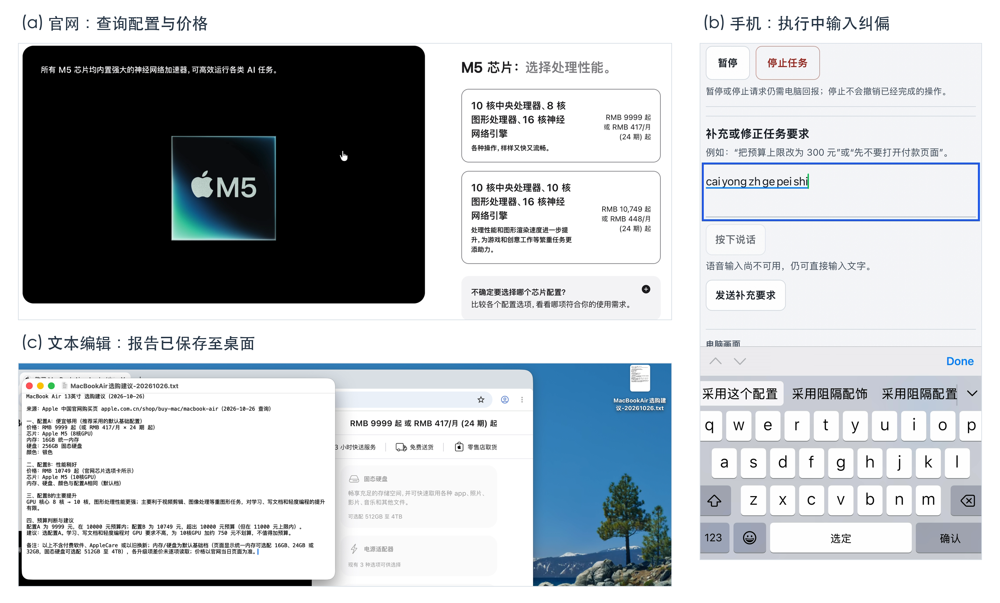

# A71-S-02｜官网选购查询、中途纠偏与桌面报告交付

难度：中等。起点：已打开的浏览器与文本编辑文稿。实际日期：2026年10月26日，时区 Asia/Shanghai。

**展示结论：真实执行链路通过，可作为用户交互式 Demo；报告内容准确性未通过，完整业务与严格验收不签通过。** 本例展示用户根据执行情况及时纠偏，系统接收纠偏要求、拦下尚未派发的旧动作，并在同一个任务中继续交付。它不表示模型自主发现并纠正事实错误，也不表示全程无人参与。

## 准备与原始委托

用户先打开待写入的文本编辑文稿，通过正常配对控制页启动任务；运行记录中的原文稿名为“空白.txt”。本例使用整个桌面截图，不以新建文稿、关闭重开或发送微信为要求。起点由用户准备，不计为模型自主完成。

> 我想买一台13英寸MacBook Air，主要用来学习、写文档和轻度编程，颜色选银色。
>
> 请在苹果中国官网比较一套便宜够用的配置和一套性能稍好的配置，告诉我各自的价格、芯片、内存、硬盘，以及贵的那套主要提升在哪里。不需要付费软件、AppleCare或以旧换新。
>
> 我的预算是10000元，最多可以增加到11000元。请简短说明推荐哪套、是否值得加预算；如果超预算就如实说明，不购买。
>
> 把比较结果和官网来源写进我已经打开的空白文本编辑文稿，保存到桌面，命名为“MacBookAir选购建议-20261026.txt”。保存成功后保持文稿打开，并告诉我结果。

上文按原 `run.created.goal` 展示，完整字符串及 SHA-256 见[证据摘要](../evidence/astra-interactive-shopping-a71-20261026/evidence.json)。中途纠偏另行登记，不倒写进原题，也不以修改后的描述回签原题全部要求。

## 实际执行过程

Run：`run-1792949639411-4e150367-ef0`。开始于01:33:59，结束于01:47:21，耗时802.283秒（约13分22秒）；81次主模型请求，75次完成动作（含观察等待）。

| 阶段 | 实际记录 | 支持的结论 |
| --- | --- | --- |
| 官网查询 | 模型在浏览器中浏览Apple中国官网购买页，尝试读取配置与价格；seq595仍准备向下滚动10格，寻找内存/硬盘选项 | 确实进行过查询；不据此认定所有配置字段均查清 |
| 用户中途纠偏 | seq596，01:43:17.795，收到“采用这个配置即可 开始完成报告” | 用户主动调整推进方向，不是模型预设询问后的固定预算回复 |
| 拦下旧动作 | seq597，01:43:17.798，同一scroll调用被拒绝，原因 `superseded by user correction`；没有该调用的 `tool.call.received` 或 `action.proposed` | 尚未派发的旧滚动被新要求取代；不是撤回已经发生的操作 |
| 接续任务 | seq600模型确认新要求，seq607更新任务计划；随后向文本编辑输入报告，seq625输入完成 | 同一个Run继续转入交付，没有重启任务；事实准确性另核 |
| 保存文件 | seq708保存前图；seq712点击保存，原图坐标约(1725.57,1043.43)；seq715回执为屏幕点(863,522) | 有实际保存点击派发，不能只依赖回执判断成功 |
| 结果核验 | seq717仍处于面板收起动画；独立wait后seq726面板关闭，窗口标题与桌面文件图标同名，文稿保持打开 | 保存有前后画面和实际文件支持，非单凭模型自报 |
| 正常结束 | seq735为 `run.finished / succeeded` | 运行正常收尾；不等同报告事实全部正确 |

桌面文件实际为1319字节，SHA-256：`fea5b2815abac00ffe60d77feff5bd37bf4ddedb279228ab4f3b852adeb4465e`。已保留[原始报告逐字节副本](../evidence/astra-interactive-shopping-a71-20261026/report-original.txt)，不修改错误字段来美化历史结果。此前同批次短Run `run-1792949577223-94265cf7-23b`由用户取消，仍保留，不计为成功。

## 可展示的亮点：监督执行、及时纠偏，继续完成交付

建议表述：**“用户可以根据执行情况随时纠偏；Computer—Harness 接收纠偏要求，在同一个任务中继续完成文稿交付。”**

已接收并审阅电脑与手机两段原始录屏，选取三个阶段补入技术报告图6。原始电脑片长约14分05秒，手机片长约8分54秒；手机录制没有覆盖完整任务，两个文件的媒体时间不能直接视为同一时钟。

| 画面 | 原片与选帧位置 | 画面可见事实 |
| --- | --- | --- |
| (a) 官网查询 | 电脑原片约03:00 | 官网芯片选项卡、两档价格与配置信息 |
| (b) 手机纠偏 | 手机原片04:48.460 | “补充或修正任务要求”输入区、输入法组合状态及“发送补充要求”按钮 |
| (c) 桌面交付 | 电脑原片约13:36 | 保存面板已关闭，文稿窗口标题与桌面文件同名，报告保持打开 |

三张图均从原始录像解码、裁切，未重绘产品界面或替换输入文字。图(b)不是完整中文要求已发送的画面；完整原文及接收、旧动作失效仍以seq596/597日志交叉核验。手机浏览器地址栏已通过裁切排除。独立截图、原片指纹及裁切坐标见[图件来源登记](./figures/sources.json)和[三图说明](./figures/shopping-correction-a71/README.md)。这次补图不重新运行任务，也不改变内容准确性结论。

这轮有一次明确的用户中途纠偏，日志还显示一条旧调用被拦截；不称“零人工参与”“模型自主纠错”或“已执行动作自动回滚”。日志不能单独证明绝无电脑手动操作，需结合原视频核对。两条日志相差3毫秒只说明本次事件记录的先后，不作为端到端纠偏延迟或通用性能指标。

## 内容准确性问题（独立于执行链路）

- **硬盘字段存在矛盾。** 报告正文写256GB，报告备注及保存后截图中的页面写可选配512GB至4TB；该字段不能作为准确商品信息展示。
- **默认配置未充分取证。** seq606写入的任务记忆承认默认内存/硬盘档位及升级差价未逐项读取，后续报告仍填入默认值；不能把用户“采用这个配置”解释为授权猜测或证明字段正确。
- **价格与具体配置配对尚未全部独立核对。** 报告中的9999元、10749元等是本轮产物所写的历史信息，不作为当前报价，也不在本次文档整理中补签准确性。

因此，运行终态和查询→写稿→保存的执行链路通过；核心业务的内容核验与全部严格验收不通过。正式展示应明确本例用于说明交互纠偏和真实应用交付，商品字段问题单列。若后续修正报告，应另存注明修订依据的版本，保留这份原件与视频；本次没有修正文稿或重新测试。

## 版本、配置与离线结果

冻结候选为 `astra-main-bd1200f-r3-a71-fullframe-1600`：基于main `bd1200ff176f9edfb00143881423bfd63e1b1e2e`的未发布本地改动，不能仅克隆该main复现。实际模型 `glm-5.3-flash`、high；完整桌面图向模型呈现时最长边1600，坐标再映射回原始桌面图。原始截图仍为3024×1964，Native继续执行原有points换算。Native二进制指纹及冻结摘要见证据JSON。

本轮运行采用用户此前明确授权的 **riskGuard off / riskModel off**，不是默认Guard验证。0审批事件不能解释为默认Guard自动放行。本轮不改变产品默认配置，也不把本例作为关闭审批的推荐。

部署前583项相关唯一离线测试和代码独审通过；这些不是583次真实任务。文档整理期间没有重跑测试或业务任务。成功后已核验466个源码与566个构建文件指纹无漂移；本次仅发布文档、图件和证据副本，保持运行版本、服务及配置不变，未发布该本地运行候选的源码。单次结果不证明稳定率、全部点击准确、默认Guard通过或手机/Relay各项专项验收全部完成。

## 证据入口

- [脱敏事件与版本证据JSON](../evidence/astra-interactive-shopping-a71-20261026/evidence.json)：原Goal、纠偏原文、旧调用关联、计划更新、保存与终态、原件SHA-256。
- [原始报告副本](../evidence/astra-interactive-shopping-a71-20261026/report-original.txt)：保留内容问题的历史产物，不是修订稿。
- 私有归档保留原始trajectory、Provider交互、完整桌面截图和核验回执；公开JSON按字段摘录，不包含私人绝对路径、凭据、旧聊天或桌面窗口清单。哈希用于与原件核对，不能单独重建或证明所有动作。
- [图6及三张原片截图](./figures/shopping-correction-a71/README.md)：本次核对查询、纠偏输入与保存后状态；不据三张静态图推定全程无人工参与或所有配置字段准确。
