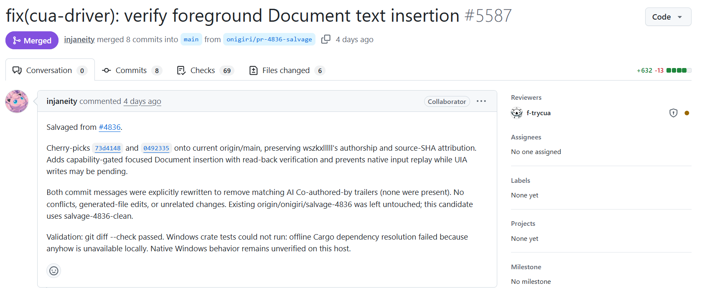
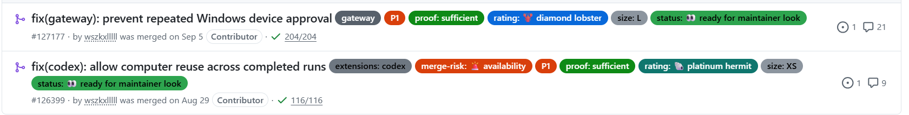

# 光语者 · 开源贡献与真实任务佐证

团队：应光　　编号：AIC-2026-88229444

作品：光语者——面向数字无障碍的桌面智能体

本文件汇集开源贡献、双平台演示、六类场景交付与任务卡。开源协作状态于2026年10月30日核对；合并日期按北京时间记录。截图来自真实GitHub页面及团队录屏，证据链接指向公开仓库中的轨迹、画面与产物。

## 一、开源贡献：Windows前台输入修复

**CUA #4500｜已于2026年10月3日合并。** 开发中发现前台输入在换行后丢失或进入其他窗口。团队提交问题复现，补充WPF与WinUI3测试夹具、文本读回和回归用例，并与维护者共同验证修复。

维护者调整了焦点恢复时机：等待目标线程读取输入队列中的标记后，再恢复原窗口焦点。PR保留了团队测试贡献说明，以及修复前后原生Windows测试的对照记录。

图A1　CUA #4500真实合并记录，显示团队贡献账号及合并状态。

**核验入口：** [PR #4500：问题、改动与测试说明](https://github.com/trycua/cua/pull/4500)；[原始问题 #4477](https://github.com/trycua/cua/issues/4477)。

**测试记录：** [修复前原生测试](https://github.com/trycua/cua/actions/runs/37106385663)、[修复后原生测试](https://github.com/trycua/cua/actions/runs/37109218138)。这些链接对应上游PR中保存的验证记录。

<!-- pagebreak -->

## 二、开源贡献：文稿输入与读回验证

**CUA #4836 → #5587｜维护者接续后于2026年10月21日合并。** 团队针对前台文稿输入提出基于无障碍控件能力的写入方案，并进行文本读回验证与结果不明时的重复输入防护。

团队原始PR为#4836；维护者通过#5587接续整合，明确保留团队提交的作者署名和来源提交编号，并进一步调整适用条件与执行处理。最终合并成果由双方协作完成。

图A2　上游PR显示已合并，并说明接续#4836、保留原作者署名与来源提交。

**核验入口：** [团队原始PR #4836](https://github.com/trycua/cua/pull/4836)、[维护者接续PR #5587](https://github.com/trycua/cua/pull/5587)、[合并版本](https://github.com/trycua/cua/commit/0525de1e6439f1e4f0edba68660b3350ac20716d)。

**团队验证记录：** 原始PR保存现代记事本写入、文末追加和独立保存文件核对的记录，并链接Windows测试与构建结果。团队将真实应用中的输入问题转化为可复现问题、代码改动和测试材料，再与上游维护者完成审阅与整合。

<!-- pagebreak -->

## 三、开源贡献：资源生命周期与设备审批

团队另外参与OpenClaw社区，完成以下两项已合并贡献。OpenClaw属于独立社区贡献项目，不是Lightspeaker的直接运行依赖。

**#126399｜Computer资源复用，2026年8月29日合并。** 一次Computer任务结束后，执行资源未被清理，下一次任务可能收到“设备忙”。修复把清理回调纳入任务生命周期，在结束、取消、超时或错误时完成释放。PR记录了同一Windows设备连续两次会话的修复前后对照及回归测试。

**#127177｜Windows重复设备审批，2026年9月5日合并。** 不同客户端对同一Windows平台使用不同名称，切换客户端时可能再次要求审批。改动统一平台元数据处理，并通过真实Windows连接、升级与拒绝条件测试，核对原有授权和安全检查。

图A3　OpenClaw两项PR的真实合并记录，均保留团队贡献账号。

**核验入口：** [PR #126399](https://github.com/openclaw/openclaw/pull/126399)、[PR #127177](https://github.com/openclaw/openclaw/pull/127177)。两项PR正文均包含问题归因、实现说明及对应验证记录。

CUA与OpenClaw的贡献链接可直接查看改动、讨论、作者和合并记录。团队详细分工见[GitHub提交](https://github.com/wszkxlllll/Computer-Harness/commits/main/)与[Pull Request记录](https://github.com/wszkxlllll/Computer-Harness/pulls?q=is%3Apr+is%3Amerged)。

<!-- pagebreak -->

### 后续协作：OpenGCUA的Windows支持

团队已向通义OpenGCUA提交Windows适配提案，希望将CUA驱动适配与跨应用任务的工程经验用于新的开源协作。维护者明确欢迎团队参与，认可相关经验，并给出保持SDK接口一致、准确报告控件能力和验证真实任务的实施要求。

团队进一步提交了Windows适配设计说明，明确SDK方法、控件能力与CUA操作之间的对应关系，分析输入、目标引用、后台操作及进程生命周期等实现问题，并公开浏览器、Excel和Word的初步实验记录。适配设计保留公共SDK接口及任务运行语义，在平台层处理差异；通过结构化操作与程序化执行，探索减少长任务中的重复模型往返。

**公开讨论：** [Windows支持提案 · Issue #5](https://github.com/Tongyi-MAI/OpenGCUA/issues/5)、[维护者实施要求](https://github.com/Tongyi-MAI/OpenGCUA/issues/5#issuecomment-6408027919)。

**设计与实验：** [Windows适配设计说明 · Issue #6](https://github.com/Tongyi-MAI/OpenGCUA/issues/6)。

### 开放复用：XERJ Corpus Hub源码收录

Computer-Harness以固定版本收录进XERJ Corpus Hub，作为可供编程智能体检索的源码参考。收录页展示团队成员的“保留评测权限并集成模型服务预检”提交，链接原始仓库及版本，并保留贡献署名和Apache-2.0许可信息。该入口使项目的具体工程实现可以作为有来源的参考被检索和复用。

**公开入口：** [团队成员贡献记录](https://hub.xerj.org/contributors/betterGuo)、[Computer-Harness源码语料](https://hub.xerj.org/corpus/wszkxlllll--computer-harness)、[对应源码提交](https://github.com/wszkxlllll/Computer-Harness/commit/66cf92f639bd17a5398648c5dec7593674dffe83)。

<!-- pagebreak -->

## 四、Windows案例：跨应用任务执行与远程审批

用户通过手机委托查询10月28日上海到雁荡山、上午10点至12点出发的直达车，整理车次、车站、时刻、历时、票价和余票，再发送至微信“文件传输助手”。这一任务需要将浏览器中获得的信息带入桌面通信应用，并在发送前取得用户确认。

**用计划保留目标，用上下文衔接应用。** 模型通过Planning创建任务，记录日期、出发时段、直达车要求，以及查询、整理和微信发送的安排。Harness将该计划与已执行动作、观察结果共同组织为决策上下文。模型从携程切换到微信后，继续使用查询所得信息组织消息，无需用户重新交代需求。桌面截图提供实际画面，CUA执行点击和输入。

图A4　同一次任务的实际录屏节选：携程结果、手机审批和微信消息交付。

**把审批接入执行过程。** 发送动作进入审批后，电脑等待手机确认；用户可以查看当前画面和待执行操作，再决定是否继续。确认后，任务接续执行发送，并根据后续画面反馈结果。手机上的审批与电脑上的操作属于同一个任务，形成“提出操作—用户确认—执行—观察结果”的过程。

**演示材料：** [项目介绍与Windows任务视频](https://github.com/wszkxlllll/Computer-Harness/blob/main/docs/submission/videos/01-computer-harness-project-overview.mp4)。视频约4分30秒，展示查询、跨应用输入、手机审批、微信交付及结果播报；上图截取其中对应的真实操作画面。

<!-- pagebreak -->

## 五、macOS案例：用户纠正与任务接续

用户委托从Apple中国官网查询MacBook Air选购信息，并整理到已打开的文本编辑文稿。查询过程中，用户通过手机补充“采用这个配置即可 开始完成报告”，要求从继续浏览转入整理与交付。本例展示智能体如何在任务进行中接收新的要求，并调整尚未执行的操作。

**纠正作用于待执行动作。** 手机补充要求经Host送入当前任务。Harness在动作执行前检查新的用户命令，使原先准备继续滚动浏览的调用失效，再将补充要求与已有任务信息一起交给模型。这样可以避免模型仍沿用旧决定继续浏览，同时保留已经完成的查询过程。

图A5　同一次任务的电脑与手机录屏节选：官网查询、手机补充要求、文稿保存后的桌面状态。

**更新计划，接续交付。** 模型收到新要求后，通过Planning将任务进度和剩余步骤更新为转向文本编辑、写入文稿、保存及核验。随后执行相应操作，通过后续观察检查保存面板关闭及文稿标题变化，再结束任务。计划保存阶段安排，上下文带入新的用户要求，执行循环据此继续推进，用户无需取消任务后重新开始。

**演示材料：** [108秒双屏Demo](https://github.com/wszkxlllll/Computer-Harness/blob/main/docs/submission/videos/02-computer-harness-macos-shopping-correction-demo.mp4)，展示官网查询、手机补充要求与文稿保存；对应实现见[该次演示的公开源码](https://github.com/wszkxlllll/Computer-Harness/tree/astra-a71-interactive-demo-20261026)。

<!-- pagebreak -->

## 六、场景覆盖与实际交付

仓库已汇集六类场景的20项通过任务记录，覆盖 Windows 与 macOS。信息查询以官网页面核对，文稿任务检查保存内容，消息任务检查接收对象和实际发送结果。下表列出实际交付；每题完整需求与证据入口见后附任务卡。

| 场景 | 任务覆盖 | 实际交付 | 公开证据 |
| --- | --- | --- | --- |
| 政务办事（3项） | 敬老卡使用、居住证签注、老年津贴 | 官方规则说明；大字津贴提示文档 | [任务及证据](../evidence/windows-success-20261029/README.md) |
| 就医准备（3项） | 协和内分泌科、口腔科；华山来院交通 | 科室位置与就诊准备说明；微信交通备忘 | [任务及证据](../evidence/windows-medical-utilities-20261029/README.md) |
| 购物售后（4项） | 音箱比较、预算筛选、退货说明、预算更新 | 含官网来源和查询日期的选购建议、退款备忘 | [任务及证据](../evidence/macos-shopping-personal-20261029/README.md) |
| 出行票务（3项） | 时段内车次比较、驾车方案、查票后发送 | 车次和路线答复；微信单条行程消息 | [任务及证据](../evidence/windows-success-20261029/README.md) |
| 生活缴费与社区服务（3项） | 惠州农业电价；两种演示燃气账单 | 电价构成、跨档费用计算和地址核对说明 | [任务及证据](../evidence/windows-medical-utilities-20261029/README.md) |
| 通信与个人事务（4项） | 通知整理、冲突调整、消息发送、计划修改 | 待办与安排文稿、微信备忘、重开核对的计划副本 | [任务及证据](../evidence/macos-shopping-personal-20261029/README.md) |

证据包包含实际题面、运行配置、执行轨迹、关键截图及交互记录。macOS文稿任务还附有实际文本产物，清单记录文件哈希，便于下载后核对。纠正、操作重试和审批按实际记录保留在相应任务卡及证据包中。

<!-- pagebreak -->

### 自主机制与代表任务对应

**计划与任务记忆衔接跨应用交付。** 出行任务T03创建查询与交付计划，将车次、时刻、票价和余票写入本次任务记忆，随后切换微信，完成确认与发送。购物任务S03将官网退货期限、起算条件和退款说明写入任务记忆，再写入桌面备忘。轨迹中的计划或记忆更新与后续正文相对应，展示查到的信息如何进入实际交付。

证据：[T03轨迹及截图](../evidence/windows-success-20261029/T03.zip) · [T03微信交付画面](../evidence/windows-success-20261029/T03-final.png) · [S03轨迹与实际文稿](../evidence/macos-shopping-personal-20261029/S03.zip)。

**纠正使旧决定失效，并改变最终产物。** 购物任务S04进行中，预算由3000元改为1500元。Harness接收新要求，阻止尚未执行的旧调用，模型沿用已查到的产品信息重新组织建议，最终文稿采用1500元预算并推荐1099元型号。该次任务记录1次纠正和3项审批，包含对旧稿的拒绝与更新后文字的确认。

证据：[S04纠正、审批与文稿](../evidence/macos-shopping-personal-20261029/S04.zip) · [S04最终画面](../evidence/macos-shopping-personal-20261029/S04-final.png)。

**执行核对延伸到文件重新打开。** 个人事务任务CM04修改预先准备的计划副本，把活动室203改为205、笔记本改为水杯，并保留日期与两项安排。任务经过2次纠正、2项审批及操作重试，完成保存、关闭、重新打开与正文核对。包内保留原始输入和最终文本，原稿前后指纹一致，最终副本呈现三条更新后的清单。

证据：[CM04轨迹、原稿与最终文稿](../evidence/macos-shopping-personal-20261029/CM04.zip) · [CM04重开后的画面](../evidence/macos-shopping-personal-20261029/CM04-final.png)。

**消息确认与实际发送分步完成。** 通信任务CM03先展示完整备忘供本人确认，随后在Harness审批后向文件传输助手发送一次。交付内容包含时间、地点、截止与携带物；发送后的消息气泡和清空的输入框用于核对结果。该次记录保留本人确认、5项审批以及操作重试。

证据：[CM03交互记录及已发送文字](../evidence/macos-shopping-personal-20261029/CM03.zip) · [CM03最终消息](../evidence/macos-shopping-personal-20261029/CM03-final.png)。

<!-- pagebreak -->

## 七、六类生活任务卡

下附任务卡与仓库已发布的题面保持一致，按六类生活需求编排。任务状态、实际交付及纠正、重试和审批说明随各题列出；Demo题面对应前述Windows视频。
