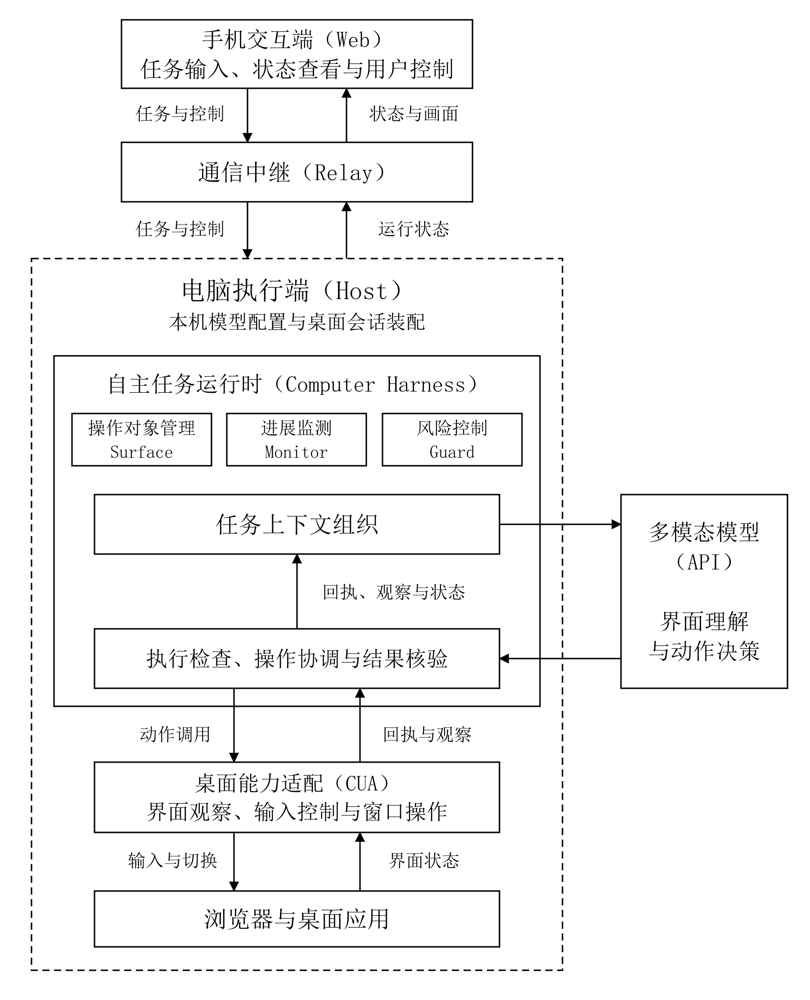
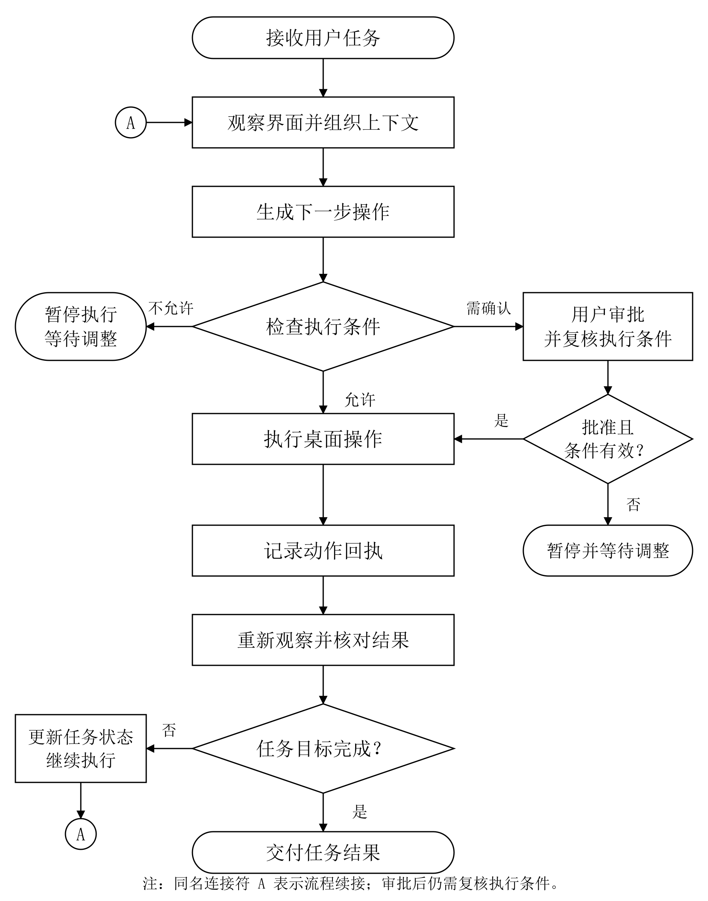
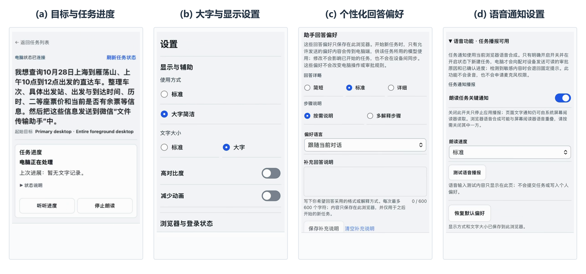
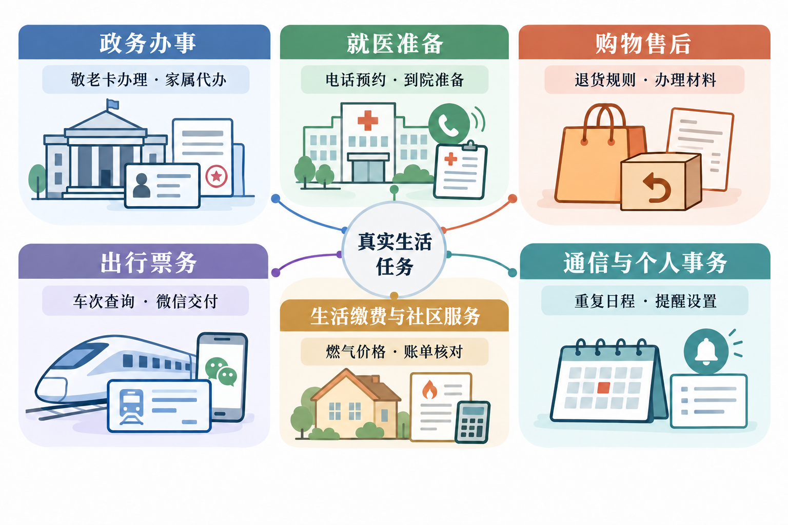
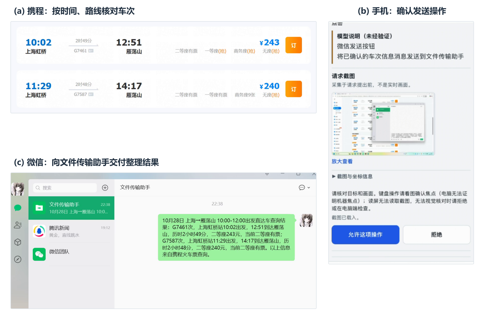

# Lightspeaker

## 手机协同桌面智能体：从开源操作能力到可靠任务执行

申报方向：开源赋能的 AI 应用创新

融合特色：开源项目改进与生态贡献

团队名称：〔填写〕

团队编号：〔填写〕

## 一、作品概述

如果家中长辈想为自己安排一次出行，可能需要在出行平台比较车次、通过地图确认接驳，再将整理好的信息发送到微信。类似的需求广泛存在于政务办事、就医准备、购物售后等日常生活中。完成这些事务往往需要访问不同网站、切换应用、核对信息并交付结果，对老年人及不熟悉数字工具的用户尤其繁琐。

多模态大模型已具备理解界面、规划操作的能力，开源 Computer-Use 工具也提供了桌面观察与输入控制的技术基础。然而，真实任务涉及持续变化的界面和操作状态：窗口切换可能使原有操作目标失效，工具调用成功未必意味着任务完成，用户临时修改要求也需要及时影响后续执行。如何将模型与桌面操作能力组织成可靠、可控的完整任务流程，是本项目关注的问题。

**Lightspeaker 是一套面向日常生活的手机协同桌面智能体。** 用户通过手机文字或语音交代需求，由自己的电脑在真实网站和桌面应用中执行任务，并通过手机查看进度、补充要求、纠正操作和确认关键步骤。系统提供大字显示、读屏支持、语音播报和个性化配置，关注老年人、低数字素养用户及其他具有不同交互需求的使用者。

项目以开源 CUA 为底层操作基础，自主开发 **Computer Harness** 运行时，统一管理任务状态、跨应用操作、执行结果、风险控制与用户介入。通过执行后重新观察、操作对象有效性检查和受控恢复等机制，支持智能体在动态桌面环境中持续推进任务。手机交互与运行时控制相结合，使用户能够委托操作，同时保留对重要行为的决定权。

作品申报 **“开源赋能的 AI 应用创新”** 方向，融合“开源项目改进与生态贡献”。目前已围绕政务、就医、购物、出行、社区服务及个人事务六类场景开展真实任务测试，形成了信息查询、跨应用整理与交付等代表性案例。开发过程中，团队还与 CUA 上游维护者共同定位和修复 Windows 输入问题，相关成果已合并，并向 OpenClaw 社区贡献了两项已合并修复。项目形成了从开源技术应用、自主系统开发、真实任务验证到社区协作的完整实践成果。

## 二、需求分析与总体方案

### 2.1 从操作界面回到生活目标

生活任务往往存在“目标简单、操作分散”的特点。用户想知道如何取消一次电话预约，实际需要辨别医院官方说明、找到预约与取消的不同条目，并核对证件和时限；用户想给家人发两班合适的火车，实际需要比较日期、车站、时刻和余票，再到另一应用完成交付。单个界面操作的难度并不一定高，困难来自条件在多个步骤之间持续有效。

对于老年用户、低数字素养用户和存在阅读障碍的使用者，这种分散还会带来额外负担：小字难读、状态提示不明显、不同应用交互不一致，以及出错后不知道如何返回。将每个页面都改成大按钮，无法独立解决跨应用过程中的理解与控制。因此，Lightspeaker把完整事务作为基本单位，允许用户说出目标，在必要时补充信息，并通过文字、声音或实际画面理解任务进行到了哪里。

真实任务同时包含不同程度的后果。阅读公开说明、整理草稿与向外发送消息，虽然可能只相差一次点击，用户需要保留的决定权却不同。任务执行应当在普通步骤中流畅推进，在发送、提交等关键步骤前清楚说明将发生的事情，并让用户能够确认或停止。风险控制由执行过程承接，避免用户为了完成普通查询而反复切回电脑控制台。

### 2.2 系统整体形态

系统由手机Web、Relay中继、电脑Host和Computer Harness组成。手机负责目标输入、状态查看和用户决定；Relay连接两端并转发受约束的任务消息；Host持有本机模型配置、桌面连接和受管浏览器状态，装配任务执行环境；Harness运行模型决策与桌面执行循环。电脑主动连接Relay，手机通过配对获得相应电脑任务的控制入口。

图1　Lightspeaker的交互、任务运行与桌面执行关系。手机操作与模型决策进入同一个任务控制层；底层桌面能力由CUA及其平台适配提供。

用户发起任务后，Host冻结本次目标、模块开关、预算与操作范围，再建立一次运行实例。模型读取当前界面和必要上下文，提出工具调用；运行支撑层检查调用并派发，记录回执，获取新画面，再继续模型决策。用户从手机提交的纠正、审批或停止命令也进入这次运行实例，而非另建一个与执行脱节的聊天过程。

这一部署方式保留了用户已有的电脑应用和账户环境。专用受管浏览器提供可复用的登录配置，微信、编辑器等原生应用通过桌面能力参与任务。手机不保存模型密钥或原生窗口句柄，也不需要把电脑画面变成可以精确点按的小型远程桌面。用户委托的是事务，系统在授权范围内组织应用操作。

### 2.3 实施可行性与成本

Lightspeaker 充分利用现有开源技术与云端模型服务，降低了桌面智能体系统的开发门槛。项目使用 GLM、Qwen 等模型 API 完成多模态理解与决策，以 CUA 项目[1]提供底层桌面操作能力，无需自行训练大模型或配备专用 GPU。主要开发和测试在团队已有的 Windows、macOS 设备上开展，手机端采用 Web 技术，远程中继服务也无需承担模型推理计算。

软件方面，项目基于 Node.js、TypeScript 及相关开源框架开发，通过自动化测试和持续集成降低多平台维护成本。测试任务主要来自真实生活场景，使用公开网站、实际桌面应用及授权的测试资料，无需大规模标注数据集。运行成本主要包括按量计费的模型 API、语音识别服务及中继服务器费用，可根据测试规模控制投入。

开发采用分阶段迭代方式，先完成核心执行链路，再逐步接入跨应用管理、手机控制、语音和辅助交互，并通过真实任务测试持续改进。目前已形成可运行的系统及相应的工程验证记录，证明上述方案能够在学生团队现有设备与开发周期内实施。

## 三、AI 技术与开源及第三方资源选择

### 3.1 AI 技术的作用

Lightspeaker 使用多模态大模型理解自然语言任务，结合实时界面截图、历史操作和任务状态进行规划与决策。相比针对特定网站编写固定脚本，模型能够根据不同应用的界面变化选择操作入口、提取信息和调整步骤，使系统具备处理开放式桌面任务的能力。

项目接入 GLM、Qwen、DeepSeek 及火山方舟等模型调用渠道，通过统一接口适配不同服务的输入与工具调用协议。语音识别服务将用户口头指令转换为文本，辅助完成任务输入和纠正。

模型提出的动作需经过工具参数、权限及风险检查，并结合执行回执与后续界面观察判断实际效果。信息查询与任务交付结果则通过来源页面、运行记录和最终产物进行核验。

### 3.2 开源及第三方资源选型

项目采用 trycua 社区的开源 **CUA** 作为桌面操作基础，利用其截图、输入和窗口控制能力连接浏览器与原生应用，减少自行实现底层驱动的成本。Windows UI Automation、macOS Accessibility 和受管浏览器 DOM 提供可选的界面结构信息，与视觉操作相互补充。

手机端与远程通信基于 React、Fastify、WebSocket 等开源组件实现，TypeScript、Vitest 和 GitHub Actions 支撑工程开发与验证。模型推理、语音识别使用第三方服务，任务语音播报利用浏览器和设备系统能力。演示视频的产品介绍另使用豆包语音合成服务制作旁白，并与真实任务录屏中的系统播报明确标识。

上述资源的具体版本、来源、许可证、使用方式及相关义务，在独立的《开源及第三方资源使用清单》中说明。

### 3.3 自主开发与权利边界

团队自主开发的核心成果包括 Computer Harness 运行时、桌面适配与任务状态管理机制，以及 Lightspeaker 的手机控制、语音交互、个性化配置和人机协作功能。系统通过统一协议组织模型决策、桌面执行、任务记忆、风险审批与用户纠正，支持不同模型和平台适配。

项目原创代码采用 Apache-2.0 许可证。CUA 及其他第三方组件遵循各自许可，模型 API 按相应服务条款使用。开发过程中使用 AI 工具辅助编程、测试和文档编写，团队负责方案设计、代码审查与实际验证；与上游维护者共同完成的贡献按实际提交和合并记录说明。

### 3.4 AI 与开源技术的融合

Lightspeaker 将多模态模型的界面理解能力、CUA 的桌面操作能力与自主开发的 Computer Harness 结合，形成从用户提出需求、模型规划、实际操作到结果核验的完整执行流程。

Computer Harness 在模型和底层操作工具之间提供持续的任务管理：维护跨应用操作对象，记录动作回执与界面变化，处理执行异常及用户纠正，并将运行状态同步到手机端。这些机制使通用 AI 能力能够进一步应用于涉及多个网站、桌面程序和人工确认的生活任务。

开源协作也贯穿项目开发。团队在真实使用中发现 CUA 的 Windows 输入异常，通过独立复现和回归测试与上游维护者共同推动修复，并向 OpenClaw 提交相关工程改进。具体技术成果与社区贡献将在后续章节展开。

## 四、系统设计与实现

### 4.1 核心流程：从用户委托到任务完成

Lightspeaker 将用户的一次委托组织为完整的任务运行过程。用户通过手机输入文字或语音，选择操作范围并发起任务；电脑端 Host 创建对应的 Run，建立桌面操作会话，装配模型、工具及任务状态模块。后续的界面观察、模型决策、动作执行、用户纠正和最终结果均归属于同一次运行。

Computer Harness 负责协调这一过程。模型根据任务目标、当前画面和相关上下文提出操作，Runtime 检查工具参数、执行权限和风险条件，再通过 Computer Adapter 调用 CUA 完成桌面动作。执行结果与新的界面观察被记录，并用于后续决策。手机端通过同一运行状态查看进度、补充要求或处理审批。

系统采用统一的工具注册与组件装配机制，支持接入不同模型和 Computer Adapter，并按需启用 Planning、Memory、Monitor 等模块。工具接口、任务状态与执行控制相互独立，使模型或底层驱动的替换无需重新实现整套任务流程。

### 4.2 跨应用任务连续性

真实桌面任务经常涉及窗口、页面和应用切换。浏览器打开新页面、编辑器弹出保存对话框，或者 Agent 从网页切换到微信，都可能改变当前操作目标。如果继续使用旧画面中的坐标或控件信息，就可能操作错误的对象。

为此，Computer Harness 设计了 **Surface Registry**，管理任务中涉及的桌面、窗口、浏览器页面及具有明确归属关系的子界面。系统为操作对象维护任务内身份、当前活动状态和版本信息。当窗口或页面发生变化时，原有引用可以失效，后续操作需要重新确认目标。

跨应用切换通过受控的窗口发现与选择完成。模型可以在授权范围内获取候选窗口并请求切换，Runtime 随后结合平台返回的窗口身份、前台状态和新画面重新确认操作对象。对于保存对话框等临时界面，系统根据可验证的父子关系管理其进入与退出，避免将无关窗口误认为当前任务的一部分。

在界面定位方面，系统以视觉截图为通用基础，并支持结合 Windows UI Automation、macOS Accessibility 和受管浏览器 DOM 获取控件结构信息。结构信息能够辅助定位具有明确名称、角色或边界的元素；缺少可靠结构信息时仍可使用视觉操作。两种方式共用操作协议，并在执行前检查引用与当前界面的匹配关系。

通过上述机制，任务能够在多个应用之间保留已有目标和进度，并根据变化后的真实界面继续执行。

### 4.3 可靠执行与结果核对

Computer Harness 将桌面操作组织为连续的执行闭环：

**观察 → 决策 → 准入检查 → 执行 → 动作回执 → 重新观察 → 状态核对**

图2　桌面任务的执行闭环与审批分支。主线依次完成观察、决策、条件检查、执行和结果核对；任务未完成时更新状态，经连接符A进入下一轮。纠正、暂停与恢复在执行边界更新任务状态。

这一设计源于真实 GUI 操作中的一个问题：工具调用返回成功，并不能证明目标应用已经产生预期结果。例如，输入工具可能成功派发键盘事件，但编辑器尚未接收完整文字；点击发送按钮之后，也需要确认消息是否实际出现在目标会话中。

Runtime 将模型请求、实际动作和执行回执分别记录，并将动作后的新观察提供给下一轮决策。模型可以结合回执与当前界面判断操作是否生效，Monitor 则提供界面变化、重复动作等辅助证据。对于最终业务结果，系统保留对应的截图、轨迹和产物，供进一步核验。

执行过程中还需要区分明确失败与结果未知。如果动作可能已经产生副作用，却因为连接中断等原因未能取得确定回执，系统不会直接重复发送或写入，而是先重新观察当前状态，在条件允许时恢复执行，必要时请求用户确认。

运行事件与任务快照采用统一管理方式，手机端、终端和运行轨迹能够读取一致的状态。用户纠正、审批和暂停等操作也进入同一执行过程，避免远程界面与电脑实际动作相互脱节。

### 4.4 上下文管理、进度监测与恢复

跨应用任务通常需要多轮模型交互。随着操作推进，历史截图、工具回执和用户要求不断增加，模型既需要保留重要条件，也需要避免继续使用过期信息。

Computer Harness 将相关能力划分为三个部分：**Context 组织模型当前需要的信息，Planning 维护任务阶段与进度，Run Memory 保存后续执行仍需使用的事实。**

Context 根据预算组织任务目标、当前观察、近期操作、计划状态、相关记忆和用户纠正，并保留必要的工具调用与回执关系。Planning 用于记录阶段目标、完成情况和阻塞事项；Run Memory 管理车次、日期、地点等任务事实，并通过更新与有效性检查减少旧信息对后续决策的影响。

**任务规划（Plan）维护可持续更新的阶段状态。** 模型通过工具创建、查询和更新任务，记录阶段目标、进展、阻塞和交接结果；Context 将未完成事项提供给后续决策。例如，出行任务可以按“查询与比较—整理结果—确认并交付”维护阶段，而不为每次点击建立计划。跨应用或接受用户纠正后，模型仍能从已有阶段状态继续推进。

**运行内记忆（Run Memory）保存继续任务所需的事实。** 模型可以写入、查询、更新事实，并将需要重新确认的信息标为待核实。系统记录事实来源和适用范围，区分稳定信息、当前任务信息和短期界面信息；在召回时先检查范围及状态，再按相关性和上下文预算选择内容。有效事实与待核实信息分开呈现，已被替代的内容退出有效召回，帮助模型区分“可以继续使用的信息”和“需要回到界面确认的信息”。

Plan 负责“任务做到哪里”，Memory 负责“继续执行需要记住什么”，两者通过 Context 参与同一执行循环。它们均使用统一工具注册机制，可以按任务配置独立启用；允许组合的计划或记忆操作可与GUI动作在同轮返回，避免为每次状态维护单独增加模型请求。

系统还通过 Monitor 分析近期动作和界面变化，识别重复尝试、无明显进展等情况，并向后续模型决策提供有界提示。监测结果作为辅助判断依据，不直接替代模型的任务决策。

这些机制共同服务于长程任务的连续执行。例如，用户在查询车次后修改出发日期，系统需要保留已经明确的出发地、目的地等条件，更新新的日期要求，并重新核对受影响的信息，而无需完全重新开始任务。

### 4.5 手机协同、语音交互与用户控制

Lightspeaker 将手机设计为用户参与桌面任务的主要入口。任务执行仍在电脑端完成，手机负责目标输入、进度查看、操作纠正和关键确认。用户可以查看实际桌面截图与任务状态，在需要时暂停、恢复或终止后续操作。

语音输入通过识别服务转换为自然语言指令，接入与文字输入相同的任务流程。系统根据任务事件和当前观察生成必要的进展通知，并通过手机端语音合成播报。普通鼠标点击不逐项播报，重点反馈已完成的阶段、遇到的阻塞以及等待用户确认的操作。

针对不同使用者，手机界面还提供大字、高对比度、读屏支持、减少动画和个性化回答偏好等功能。用户可以调整说明详略、语言和补充要求，相关偏好在新任务启动时纳入上下文，但不会改变原有的安全与权限规则。

**无障碍交互通过手机Web接入系统读屏能力。** 页面为按钮、输入框和设置项提供明确名称、分组与状态，组织焦点顺序，并在对话框、审批和任务状态变化时提供相应的焦点或文本反馈。运行通知按完整语句组织，通过无障碍状态区域供读屏读取，使用户可以按语义了解任务和调整设置，而不只依赖按钮所在的位置。系统读屏与应用主动语音播报分别配置；审批原因、进展和结果同时保留为可访问文字。

风险控制与用户纠正直接参与 Runtime 执行。对于需要确认的操作，系统将审批请求绑定到具体动作及其当前状态，用户可以在手机上查看并决定是否继续；执行前仍需核对操作条件。用户补充或修改任务要求后，尚未执行的旧决定可以失效，由模型根据新要求和当前画面重新决策。

由此，手机、语音和辅助交互与底层运行机制相互配合，使不同使用者能够以更熟悉的方式委托任务、了解过程并保留关键决定权。

### 4.6 开发过程、团队协作与验证

项目采用分阶段迭代的开发方式，从基础桌面操作与模型工具调用开始，逐步完善任务运行协议、跨窗口与跨应用管理、执行控制、手机远程交互、语音及个性化功能。各阶段通过代码提交、自动化测试和真实桌面任务验证，记录功能实现与问题修复情况。

团队围绕运行时与桌面适配、手机交互与通信、真实任务测试与工程验证等工作开展协作，并通过代码审查和交叉测试检查模块之间的接口及实际运行效果。

开发中使用生成式 AI 工具辅助代码编写、测试设计、问题分析和文档整理。团队负责确定技术方案，审查生成内容，并通过自动化测试、实机复现和最终结果核对验证实现的正确性。第三方代码、模型服务和开发工具的来源及许可按照相应条款检查。

实际测试发现的 Windows 输入异常、窗口切换和任务恢复问题，持续推动系统修订，其中部分底层问题进一步形成了向 CUA 上游提交的复现、测试与修复贡献。

## 五、真实场景验证与成果展示

### 5.1 产品形态与交互

Lightspeaker 将手机作为生活任务的委托与控制入口，电脑负责在真实网站和桌面应用中执行。用户可以输入文字或语音、查看当前进度与实际画面，在需要时补充要求、纠正操作，并确认关键步骤。图3展示了实际录屏中的任务页、显示设置、个性化偏好与语音通知设置。

图3　手机端实际界面节选。（a）目标与任务进度；（b）大字及显示设置；（c）个性化回答偏好；（d）语音通知设置。画面取自团队实录，仅作裁切与排版。

手机端的大字、高对比度、减少动画与系统读屏适配，和任务过程中的文本、语音通知共同构成辅助交互方案。用户可以按自己的阅读习惯调整说明详略与表达方式，相关偏好随新任务进入上下文，参与后续回答与进度表达。

### 5.2 真实任务测试的组织

团队围绕六类真实生活场景开展了若干任务测试，使用实际官方网站、桌面应用与授权账户环境，覆盖信息查询、条件核对、内容整理、应用切换和结果交付。每次运行明确目标、起始页面或应用、允许操作及交付要求，并保留必要的截图、动作回执和运行轨迹。

测试关注三个相互联系的方面：一是模型能否根据用户需求理解页面与组织操作；二是运行时能否在界面变化、跨应用和用户介入时维持任务连续性；三是手机上的进度、审批与最终内容能否与电脑执行过程对应。来源页面、文件内容或应用中的新增消息用于核对实际交付，测试反馈持续用于完善运行控制和交互体验。

### 5.3 六类生活场景与代表任务

图4概括了任务覆盖的六类生活场景。各类别根据日常需要组织具体委托，既包含单一网站的信息整理，也包含需要桌面应用参与的操作与交付。

图4　六类真实生活任务覆盖及代表委托。类别划分用于组织真实任务测试。

政务办事以上海敬老卡办理及家属代办条件查询为例，关注官方入口、办理对象和材料要求。就医准备以华山医院电话预约、到院准备与取消要求为例，将分散的办事说明组织为便于使用者阅读的信息。购物售后以 Apple 中国大陆实体零售店退货咨询为例，关注购买渠道、办理时限和材料等适用条件。

出行票务覆盖车次查询、条件比较与微信交付；生活缴费与社区服务涉及燃气价格和账单核对；通信与个人事务涉及日历重复日程、提醒设置等日常安排。这些任务共同用于检验信息获取、状态维护和人机协作在不同应用环境中的使用方式。

### 5.4 代表 Demo：跨应用执行与用户介入

#### 5.4.1 查车次并通过微信交付

用户通过手机委托查询指定日期上海至雁荡山、上午10点至12点出发的直达列车，整理车站、时刻、历时、二等座票价和余票，再发送至微信“文件传输助手”。电脑在携程查询并整理信息，随后切换到微信；用户在手机确认发送操作后，系统完成消息交付并反馈结果。

图5　同一次跨应用任务的实际执行画面。（a）携程车次查询；（b）手机发送审批；（c）微信中的结果消息。三幅画面按查询、确认、交付三个阶段截取自同一次任务录屏。

这一案例将手机委托、动态网页查询、跨应用执行和关键操作确认连接为完整流程，展示了 Computer Harness 对任务连续性和用户控制的支撑。随作品提交的演示视频保留真实执行与任务播报，并展示产品交互及开源贡献；等待片段的变速和后期产品旁白均在视频中标识。

#### 5.4.2 商品查询、手机纠偏与桌面报告交付

用户通过手机委托比较 MacBook Air 的两套配置，并将选购建议写入已打开的文本编辑文稿、保存至桌面。电脑在 Apple 中国官网查询配置与价格；用户查看执行情况后，在手机端输入纠偏要求“采用这个配置即可 开始完成报告”。系统接收要求，使尚未执行的旧滚动操作失效，随后在同一个任务中转入写稿和保存，最终保持已保存文稿打开。

图6　同一次 macOS 任务的实际执行画面。（a）官网配置与价格查询；（b）手机端输入纠偏要求；（c）文本编辑中的已保存报告与桌面文件。三幅画面分别截取自这次任务的电脑、手机原始录屏，按查询、纠偏、交付三个阶段排列，并非同时发生。手机帧保留输入法组合状态；正文中的完整纠偏文字取自该次任务日志。

这一案例展示了 Computer—Harness 对执行监督和用户及时纠偏的支持：用户可根据执行情况介入，系统依据纠偏要求接续后续操作，无需重新启动任务。展示重点是用户参与下的真实应用交付；运行配置、内容核验及验收边界见[商品查询与中途纠偏案例](./interactive-shopping-demo-a71.md)，不将单次演示扩大为稳定率或全部严格验收通过。

### 5.5 工程验证与迭代

真实任务测试与工程验证共同推进系统开发。项目通过自动化测试检查工具协议、任务状态、上下文组织、模块组合、资源清理和 Host/Relay 通信，通过真实模型接口与原生应用测试核对调用、窗口和输入行为，并在 Windows 与 macOS 环境开展平台适配验证。

GitHub Actions 承接构建与回归检查，代码审查和实际使用反馈用于完善跨应用操作、用户纠正、审批及手机交互。开发中发现的底层输入问题进一步形成独立复现和测试夹具，与 CUA 上游维护者的协作相衔接，使产品迭代和开源基础改进形成持续联系。

## 六、创新性与开放价值

### 6.1 面向真实任务的系统创新

Lightspeaker 的创新体现在开源技术的系统化应用与面向真实用户的交互设计两个方面。

在技术层面，项目基于多模态模型和开源 CUA，自主开发 Computer Harness 运行时，将跨应用状态管理、执行结果核对、任务上下文和用户控制整合为统一的执行机制。相较于直接连接模型与桌面操作工具的基础方案，Computer Harness 能够持续管理当前操作对象，在界面变化后重新确认引用，区分动作回执与实际结果，并在失败或结果不确定时采取受控恢复。统一的模块接口还支持替换模型、桌面适配和运行策略，为不同任务中的能力复用提供基础。

在应用层面，Lightspeaker 将手机交互与实际桌面执行连接起来。用户通过文字或语音提出需求，在手机上查看进度、补充要求和确认关键操作。系统还提供大字、读屏支持、进展播报及个性化配置，关注老年人和数字工具使用门槛较高的群体。上述交互直接参与任务运行，使用户能够以熟悉的方式使用智能体，同时保留对关键操作的决定权。

### 6.2 开放成果与复用价值

项目原创代码采用 Apache-2.0 许可证，项目成果包括 Computer Harness 运行时、桌面适配、手机协同控制、任务协议、测试工具及技术文档。

开发者可以基于统一接口替换模型服务、调整任务规划与记忆策略，或接入其他桌面环境；也可以利用已有测试和运行记录分析智能体执行过程。项目提供的真实任务案例、问题复现和回归测试，为相关工具的开发和验证提供了参考。

上述成果通过 GitHub 仓库维护，第三方组件分别遵循其许可证与服务条款，开放范围以仓库中的源码及授权声明为准。

### 6.3 与开源社区维护者共同解决实际问题

在 Lightspeaker 的开发过程中，团队发现 Windows 现代记事本存在多行输入异常：模型生成的内容正确，但目标应用在换行后可能出现字符丢失或错误。团队将问题从完整任务中提取，建立独立复现，并为 WPF、WinUI3 编写测试夹具，通过应用实际接收的文本验证输入结果。

这些测试帮助团队与 CUA 维护者共同定位前台焦点恢复和输入队列处理之间的时序问题。维护者进一步完善修复方案，相关改进已通过 [CUA PR #4500](https://github.com/trycua/cua/pull/4500) 合并[2]。团队贡献了问题复现、测试夹具和回归验证，使实际使用中发现的问题转化为上游可持续维护的测试资产。

双方随后继续合作解决文稿输入的可靠性问题。团队在 [PR #4836](https://github.com/trycua/cua/pull/4836) 中提出基于控件能力的前台 Document 输入方案[3]，上游维护者在 [PR #5587](https://github.com/trycua/cua/pull/5587) 中保留团队原始提交与作者署名，并进一步整合文本读回验证及不确定输入的重复执行防护[4]。该 PR 于 2026 年 10 月 21 日合并。

此外，团队向 OpenClaw 社区贡献的 [PR #126399](https://github.com/openclaw/openclaw/pull/126399)[5]和 [PR #127177](https://github.com/openclaw/openclaw/pull/127177)[6]均已合并，分别解决 Computer 任务结束后的资源复用问题，以及 Windows 不同客户端切换时的重复设备审批问题。OpenClaw 属于团队在深入 computer-use 开源生态中参与贡献的独立开源项目。

这些实践体现了项目与开源生态之间的双向关系：利用成熟的开源基础开发实际应用，再通过问题复现、测试验证和维护者协作推动基础工具的完善。

### 6.4 后续维护与社区协作

项目将持续通过 GitHub 维护代码、文档与问题反馈，完善安装指南、平台兼容性及真实任务测试。后续重点包括改进跨应用执行稳定性、补充可复现的评测案例、完善 Windows 与 macOS 的使用流程，并吸收不同用户群体的体验反馈。

团队也将继续跟进 CUA 等上游项目的版本变化与相关问题，通过测试、Issue 和 Pull Request 参与社区协作。

## 七、安全、隐私与合规

### 7.1 开源许可与知识产权

Lightspeaker 原创代码采用 Apache-2.0 许可证。项目使用的 CUA、前后端框架及其他第三方组件分别遵循其适用许可证，模型与语音识别服务按照相应服务条款调用。项目通过 LICENSE、THIRD_PARTY_NOTICES 和独立资源清单记录第三方资源的来源、版本、使用方式及许可要求，并根据实际分发内容履行署名与声明义务。

团队自主实现、第三方依赖及上游协作贡献分别说明。成员和共同权利人的贡献及授权范围按实际记录核查，不将第三方软件、服务或素材纳入项目原创代码的授权范围。

### 7.2 数据使用与隐私保护

Lightspeaker 在用户授权的电脑和账户环境中执行任务。模型凭据及受管浏览器配置由电脑端 Host 管理，手机通过配对参与任务。模型请求可能包含任务文本、界面截图与必要上下文，语音识别则使用相应第三方服务。

系统支持选择窗口或全桌面操作范围，并通过配对鉴权、设备撤销和访问限制管理远程控制。公开仓库和演示材料使用测试资料及脱敏记录，不公开真实密钥、个人登录状态或无权披露的聊天内容。对于访问到的第三方网站信息，按其实际使用授权处理，不将公开可访问内容直接视为可自由训练、改编或再分发的数据。

### 7.3 AI 输出与操作安全

多模态模型可能出现界面识别偏差、信息遗漏、错误操作或不准确的完成声明，网页内容也可能包含误导模型的指令。Computer Harness 通过工具参数校验、操作范围限制、执行回执、重新观察及风险审批等机制控制执行过程，并将外部页面内容与系统授权规则分开处理。

对于信息查询任务，项目通过来源页面核对关键事实；对于文件编辑和消息发送等任务，结合运行记录及实际交付结果进行验证。涉及敏感修改或对外提交的操作由相应风险策略与用户确认共同控制。

团队在开发过程中使用生成式 AI 辅助编程、测试和文档整理，并对生成内容进行人工审查、实际验证及必要的来源和权利核查，遵守所使用工具与服务的适用条款。

演示视频使用真实手机与电脑录屏，产品介绍旁白由豆包语音合成模型2.0的预置 Vivi 音色生成，解说文案、画面对应关系及最终剪辑由团队审核。AI 旁白与系统实际播报在画面中分别标识，片尾说明声音来源；未使用真人声音复刻。

报告中的六类生活场景示意图使用 AI 辅助绘制，用于说明任务分类；产品界面与跨应用案例截图取自真实录屏。

### 7.4 适用范围与技术限制

当前系统主要面向经过授权的日常桌面任务，执行效果仍受到模型能力、网站变化、网络环境和操作系统差异的影响。涉及资金、账户安全及其他重要权益的操作需要保留人工确认，不宜在无人监督下直接用于高风险事务。

现有适老化和无障碍功能已具备相应工程实现，其实际使用效果仍需通过更多真实用户测试验证。项目将继续完善任务稳定性、风险处理和平台兼容性。

读屏能够读取界面中的文字、控件及任务状态；窗口预览和实际桌面截图的内容辨认仍需要视觉核对或他人协助。涉及这类证据的目标选择与审批保留人工核对入口。

## 八、总结与展望

Lightspeaker 基于开源 Computer-Use 技术，构建了连接手机交互、模型决策与真实桌面执行的智能体系统。自主开发的 Computer Harness 运行时为跨应用任务提供状态管理、可靠执行、人机纠正和风险控制能力，手机端的语音与个性化交互进一步降低了用户参与复杂电脑操作的门槛。

项目已围绕六类生活场景开展真实任务测试，形成了可核验的信息查询与跨应用交付案例，并建立了相应的工程测试与开发文档。团队还通过与 CUA 维护者的共同修复及 OpenClaw 社区贡献，积累了从实际问题发现、独立复现到开源协作的完整实践经验。

后续将重点完善真实任务的稳定性与执行效率，开展统一条件下的定量评测，扩大老年用户及无障碍场景的试用范围，并持续改进平台适配、部署体验和开源文档，推动 Lightspeaker 在更多日常生活场景中得到实际应用。

## 九、附录

### 9.1 参考资料

[1] trycua. CUA开源项目[EB/OL]. [https://github.com/trycua/cua](https://github.com/trycua/cua).

[2] trycua/cua. PR #4500: fix(cua-driver): drain Windows foreground input before restoring focus[EB/OL]. [https://github.com/trycua/cua/pull/4500](https://github.com/trycua/cua/pull/4500).

[3] trycua/cua. 团队前台Document输入方案，PR #4836[EB/OL]. [https://github.com/trycua/cua/pull/4836](https://github.com/trycua/cua/pull/4836).

[4] trycua/cua. PR #5587: fix(cua-driver): verify foreground Document text insertion[EB/OL]. [https://github.com/trycua/cua/pull/5587](https://github.com/trycua/cua/pull/5587).

[5] openclaw/openclaw. PR #126399: fix(codex): allow computer reuse across completed runs[EB/OL]. [https://github.com/openclaw/openclaw/pull/126399](https://github.com/openclaw/openclaw/pull/126399).

[6] openclaw/openclaw. PR #127177: fix(gateway): prevent repeated Windows device approvals[EB/OL]. [https://github.com/openclaw/openclaw/pull/127177](https://github.com/openclaw/openclaw/pull/127177).

### 9.2 提交材料与开源入口

随作品提交的材料包括本技术报告、附后的《开源及第三方资源使用清单》，以及 Lightspeaker 演示视频。视频展示手机发起、电脑跨应用查询、手机审批和微信交付的实际流程。

项目源码、使用文档及授权声明的仓库入口如下：

- 项目仓库：[Computer-Harness](https://github.com/wszkxlllll/Computer-Harness)。
- Windows 安装与使用：[开始使用](https://github.com/wszkxlllll/Computer-Harness/blob/main/docs/getting-started.md)。
- 系统实现：[技术文档](https://github.com/wszkxlllll/Computer-Harness/blob/main/docs/technical-guide.md)。
- 项目许可：[LICENSE](https://github.com/wszkxlllll/Computer-Harness/blob/main/LICENSE)。
- 第三方声明：[THIRD_PARTY_NOTICES](https://github.com/wszkxlllll/Computer-Harness/blob/main/THIRD_PARTY_NOTICES.md)。

上游协作的公开提交与合并记录见参考资料[2]—[6]。
