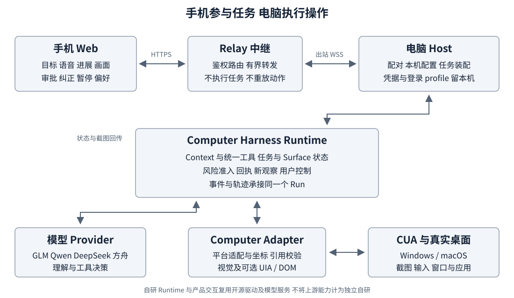
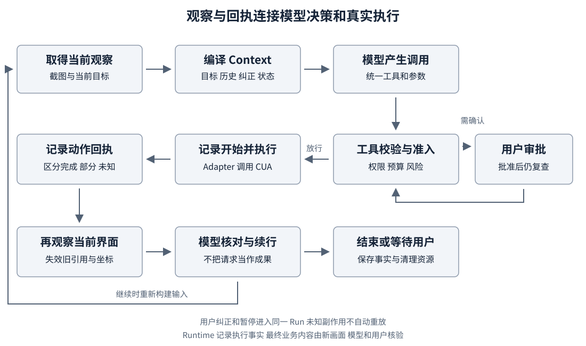

# Lightspeaker 手机协同桌面智能体技术报告

作品名称：Lightspeaker生活助手

申报方向：开源赋能的AI应用创新

融合特色：开源项目改进与生态贡献

技术内核：Computer Harness

日期：2026年10月20日

## 一 作品概述

### 背景与问题

为长辈准备一次出行，可能需要在携程比较车次、在地图确认接驳，再把结果发到微信。了解一项社区服务，往往需要找到官方网站、阅读政策、区分本人和家人代办条件。用户的需求通常是一件完整的生活事务，服务却分散在不同网站和桌面应用中。用户既要理解信息，还要完成入口查找、界面切换、文字整理与结果交付。

多模态模型已经能够根据截图判断下一步操作，开源Computer-Use工具也提供了点击、输入和截图能力。但真实任务并不总在一个页面里完成。弹窗会改变操作对象，页面加载有延迟，输入可能只执行一部分，用户也可能临时补充条件。仅把模型接到输入工具上，难以统一处理这些变化。对于不熟悉电脑操作、阅读小字困难或希望通过语音参与的用户，运行过程本身还需要容易理解、可以干预。

### 目标与作品形态

我们开发了Lightspeaker手机协同桌面智能体。用户在手机网页中用文字或语音说明目标，由自己的电脑访问网站、操作桌面应用；任务状态、实际画面和结果返回手机。执行中可以补充要求、暂停、停止，在需要审批的关键操作前决定是否继续。

作品以“开源赋能的AI应用创新”为申报主方向，并结合真实使用中形成的上游问题排查和修复贡献。对外产品是Lightspeaker，技术内核是Computer Harness。前者组织生活需求与用户交互，后者承接模型决策和真实桌面执行之间的状态、控制及恢复。

### 核心工作

我们将同一任务中的窗口变化、动作回执、后续观察和用户输入组织为统一运行过程；通过任务级状态和Surface管理维护当前操作对象；把手机、语音、审批、纠正和个性化偏好接入同一个Run。项目在真实生活任务中发现输入、切窗、重复操作和交互问题，再通过回归测试完善实现，并向CUA、OpenClaw社区反馈可复现的问题。

## 二 需求分析与系统总体方案

### 生活任务与交互需求

项目围绕政务与公共服务、就医与健康服务、购物与售后、出行与票务、生活缴费与社区服务、通信日程与个人资料六类场景开展任务设计和实际测试。典型需求不是“点击某个按钮”，而是“查清办理材料”“确认就诊准备”“整理出行信息并交给家人”。网站和应用是完成事务的入口，任务有时需要跨站，有时还需要跨应用交付。

这些需求包含不同的参与方式。熟悉电脑的用户希望减少重复操作，同时能及时纠正；阅读困难的用户需要较大字号、语音和清晰的状态；不熟悉应用界面的用户希望用自然语言表达目标，而不必理解坐标、窗口编号或工具参数。发送、提交和账户修改等操作还需要保留用户决定权。

我们的设计依据来自团队真实使用、任务轨迹、问题复现及手机交互检查。它们帮助确定了需求优先级：先把任务执行和用户控制连接完整，再完善多模态输入、进展反馈和使用偏好。产品已提供相关辅助交互，后续仍需通过更多真实用户试用了解不同群体的具体障碍。

### 总体方案

图1 Lightspeaker系统总体架构

手机Web作为用户入口，Relay连接手机与电脑，Host负责本机配置、配对及任务装配。Runtime从模型获得工具调用，经参数校验和风险准入后交给Computer Adapter执行。CUA提供底层桌面能力；执行回执与新画面回到Runtime，再投影为手机上的进度、审批、截图和结果。

电脑主动向Relay建立连接，普通用户不需要给电脑开放公网入站端口。桌面任务仍在用户的电脑和账户中运行，手机不是另一台执行Agent，也不是把鼠标缩小到手机屏幕上的远程桌面工具。模型服务承担理解与决策，中继不运行模型；系统通过有界预算、有限重试和可选择的采集能力控制执行成本。

### 可行性与投入

团队复用CUA驱动、Web框架和云模型服务，无需训练基础模型或自行实现操作系统输入栈。公共协议和装配层复用于Windows与macOS，平台权限、输入和窗口机制分别适配。手机使用浏览器界面，无需先安装原生App。实际运行需要电脑、匹配的驱动、模型凭据及可访问的HTTPS Relay；现阶段主要成本是模型调用、开发验证与中继运维。

## 三 人工智能技术与开源基础设施选型

### 多模态模型与工具调用

模型读取目标、当前截图和相关历史，选择工具并给出参数。系统支持GLM、Qwen、DeepSeek及火山方舟渠道，各Provider按相应API处理图像、结构化输出、历史回执和坐标。主循环不直接绑定某一厂商格式，新增或替换模型时仍使用统一工具和执行合同。

统一ToolRegistry向模型提供当前真正开放的工具、用途和参数。模型返回后，Runtime再次检查工具是否存在、参数是否合法、调用组合是否允许以及预算和权限。模型说明文字、计划和结束声明不直接等于执行事实；系统保留实际回执与后续画面，作为继续决策和用户核验的依据。

### CUA与Computer Harness的分工

CUA提供桌面截图、输入、窗口枚举和激活等底层能力。我们通过Computer Adapter连接CUA SDK与daemon，将其结果映射为公共ComputerSession、Observation和ActionReceipt，并处理平台差异、引用有效性和资源清理。CUA仍是独立开源基础，不将其驱动能力记为团队从零实现。

Computer Harness自主实现任务运行协议、Runtime调度、统一工具管理、Context组织、Planning与Run Memory接线、Surface状态管理、风险准入及用户控制。它解决的是底层动作在一项持续任务中如何组合、何时可以执行、结果如何记录，以及发生变化后怎样继续的问题。

Windows与macOS使用各自的原生机制，但不复制两套任务主循环。驱动的官方release、团队修复候选及上游PR是不同版本来源；实际部署按固定源码、SDK/daemon配对和校验记录管理。

### 其他开源资源与自主边界

前端使用React组织手机界面，Fastify提供Host/Relay服务，ws承载双向连接，Zod参与数据校验，二维码与文本处理库提供通用功能。团队实现的是这些基础组件之上的任务、通信与交互逻辑。Node.js、TypeScript、pnpm和测试框架承担工程构建与验证。

OpenClaw不是Lightspeaker的直接运行依赖。团队在另一个开源项目中的贡献用于说明问题排查、社区协作和技术复用经验，不画入本系统运行架构。模型API、语音识别和设备系统播报也分别按服务或系统能力说明，不称为团队自行训练的模型。独立第三方资源清单集中列出版本、来源、用途和许可边界。

## 四 系统设计与关键技术实现

### 可靠执行闭环

图2 从模型决策到回执及新观察的执行流程

任务创建后，Runtime先建立ComputerSession并观察当前界面。Context编译器组织目标、截图、合法工具、历史回执、用户纠正及已启用的状态，Provider将其投影为模型请求。模型返回工具调用后，Runtime按注册表和调用策略校验，再把GUI调用转换为动作意图。

动作开始和终态分别写入事件。Computer Adapter派发输入并返回回执，Runtime保存新的观察，再决定下一轮如何推进。UI从已提交事件和快照读取状态，不另行维护一份与执行脱节的任务真相。一次调用可以包含允许的状态工具和受限输入序列，但每个实际动作仍独立经过预算、准入、回执和观察处理。

这一设计特别关注部分执行和未知结果。如果记录了动作开始，却未取得足以确认终态的回执，系统不能把它当作“没有发生”直接重试。能够确认当前Surface及新观察时可进行受控续行；无法确认时保留用户处理边界。网络模型请求的有限重试与桌面副作用重放分开，避免一次发送或保存被重复执行。

### 跨窗口与跨应用状态管理

真实任务在浏览器、微信、编辑器和弹窗之间变化。我们保留稳定的任务级ComputerSession，在内部以SurfaceId和generation跟踪实际使用的窗口、页面及相关子界面。Registry保存身份、关系和引用状态；操作系统证据由适配层提供，而不是由Registry猜测。

用户为本Run开启跨应用能力后，模型可以列出授权范围内的已打开窗口，并用当次返回的引用请求切换。切换后重新确认身份、几何和画面，旧元素或坐标不能直接沿用。浏览器标签页和DOM还需与受管窗口保持来源关系。具有可靠关系证据的子界面按父子生命周期处理；不把所有浮层、同名窗口或同进程对象自动当成当前弹窗。

全桌面模式提供跨应用兼容执行，持续保留桌面观察。可选UIA或DOM给出补充控件候选，但不替换视觉操作的基础路径。候选不可用时，系统仍可依据完整桌面截图执行合法坐标动作。窗口范围与全桌面范围分别由用户选择，范围控制用于减少无关采集，不等同于操作系统级隔离。

### 上下文与任务状态

Context将稳定指令和工具定义与动态目标、截图、历史、纠正及模块状态分开组织。recent策略按预算选择近期历史，同时维护工具调用与结果配对及Provider续接要求。编译trace记录实际进入模型的内容和遗漏原因，便于定位信息缺失或陈旧提示。

Planning通过模型工具维护阶段目标、进度与阻塞，不要求每次点击创建任务。Run Memory保存继续任务仍需记住的事实、实体状态和适用范围，区别于任务进度及完整轨迹。事实更新、待核实和已替代状态参与召回，当前目标、纠正及相关状态提供检索线索。模块可在Run开始时独立装配和关闭，Provider仍从统一注册表获取工具，不建立分散工具清单。

这些机制为长程任务提供可检查的状态载体。实现的重点是生产、更新和消费闭环，相关效果结合真实任务记录继续优化；报告不把调用过某模块写成已经证明其独立收益。

### 风险控制和用户介入

Guard位于动作准入阶段，本地扫描结合动作效果描述判断是否需要确认；配置可支持额外语义判断，当前手机Host默认关闭额外风险模型请求，保留本地扫描和必要审批。审批绑定待执行动作及当前证据，用户批准后仍复查执行条件，不扩大为任意后续操作的永久许可。

纠正、暂停、恢复和停止都进入同一Run。用户补充新条件后，后续模型请求应使用更新目标，失效的旧决定不再直接执行。停止只限制后续动作，不能撤销已经完成的发送或保存。Monitor消费动作和观察，记录重复、无进展等信号；shadow用于观察候选提示，guidance才将符合条件的提示送入后续Context，不与安全审批混为一谈。

### 面向用户的手机语音和个性化交互

手机显示实际截图、任务状态、回复和审批内容；关键等待有明确状态，不只呈现一个始终旋转的加载提示。用户可以在任务中继续输入自然语言，而不必重新开始。远程命令区分接收与实际生效，断线后读取快照和事件，不自动重放鼠标键盘操作。

语音输入由Host管理识别会话和转写结果，播报使用手机系统SpeechSynthesis。开始、进展、需要确认及结束等通知来自任务事件投影；进展文字描述已有观察支持的情况，而不把未来动作当作完成。语速和声音由设备及偏好共同影响。

Web提供大字、较高对比度、减少动画、语义标签、焦点处理和动态状态通知。读屏内容按有意义的句子组织，尽量减少逐字段碎片化朗读。个性化偏好允许用户编辑回答详略、说明方式、语言和附加文字，在新Run开始时冻结并投影到Context；这类偏好不能修改权限或审批规则。

## 五 真实场景实践与工程成果

### 六类生活任务实践

项目已围绕六类生活场景使用真实Harness进行操作尝试。任务通过官方网站或实际应用开展，保留目标、初态、动作、画面和回复。这里集中展示任务内容与功能使用，不将不同开发版本、人工帮助和任务变体混合为总体统计。

| 场景 | 实际任务内容 | 留存的核验材料 |
| --- | --- | --- |
| 政务与公共服务 | 查询上海敬老卡本人及代办材料、金融功能激活说明 | 政府/民政来源页面、检索与导航截图、模型答复和纠正记录 |
| 就医与健康服务 | 查华山医院电话预约、到院准备及取消流程，整理就诊信息 | 医院公开说明、浏览过程、文本或文档交付记录 |
| 购物与售后 | 查Apple中国大陆实体零售店退货条件及运营商协议说明 | 官方政策页面、所引用条款、中文答复 |
| 出行与票务 | 查询携程车次及高德接驳，将出行信息整理到微信 | 查询页面、车次/路线观察、跨应用动作、审批及消息画面 |
| 生活缴费与社区服务 | 查公开燃气价格，结合本地示例账单核算与整理说明 | 价格来源、示例输入、计算与文档记录，不涉及真实缴费 |
| 通信日程与个人资料 | 阅读官方日历手册，准备重复日程与提醒说明；编辑和交付用户资料 | 手册版本页面、操作轨迹、说明文字及文件/会话证据 |

各任务覆盖的执行深度不同，资料查询、桌面写入和对外发送分别记录。项目没有把公开信息查询描述为已经完成真实挂号、银行激活或付款。任务材料与逐次记录保留为附录证据来源，便于解释功能在真实界面中如何被使用。

### 代表性跨应用案例

主演示采用“为长辈查询两班合适车次，并把简明乘车信息发送给文件传输助手”。相比单网页问答，这一流程需要读取动态信息、比较用户条件、组织文字、寻找微信窗口、确认目标会话并执行发送，能够展示系统的任务连续性和关键操作控制。

已留存的实际流程包括：受管浏览器查询携程，模型读取车次信息；必要时用户补充条件，系统在同一任务中继续；Agent切换到微信，将整理内容写入指定会话；需要审批时等待用户确认；随后从新画面核对本次消息。记录将本Run的新消息与历史相似内容区分，不以模型结束声明替代交付画面。

该次验收使用已有登录与表单状态，包含人工日期纠正和审批，已核对电脑查询及本Run的新消息送达；手机画面与声音将在正式重录中同步记录。

正式Demo围绕上述成功流程录制手机发起、电脑执行、手机确认和实际成果。最终素材使用测试会话与可公开内容，等待片段可压缩并注明，保留原片。手机的语音、截图和纠正作为真实交互展示，不制作模拟手机界面或事后伪造播报。

### 工程验证

项目采用TypeScript项目构建、Vitest与Node自动化测试，验证协议校验、事件重建、工具组合、模块开关、资源清理、Host/Relay转发和Web交互。CI从锁定依赖开始安装、构建核心与Web产物、运行离线测试并检查CLI帮助入口；Windows和macOS均有对应构建测试任务。

真实模型接口、原生输入、浏览器状态、手机访问和跨应用任务分别保留验证记录。Windows的输入与全桌面路径和macOS的权限、窗口及编辑路径由具备环境的成员实测，不用离线CI替代桌面证据。真实使用发现的问题反过来形成最小复现、回归用例和适配修复，使测试直接服务产品完善。

## 六 创新特点与开源协作

### 面向真实任务的Runtime设计

本项目的技术特点在于把模型决策之后的执行过程作为独立系统对象管理。Surface身份与引用新鲜度、动作开始及回执、新观察和未知副作用处理相互连接，用户纠正与审批也由同一运行生命周期承接。它使界面变化、部分执行和用户介入有共同的处理位置，而不是由不同入口各自补一套临时逻辑。

系统通过工厂和公共合同支持模型、Computer、Context及Plan/Memory策略替换。默认实现可复用，替换实现仍遵循事件、状态、预算和清理语义。开放成果包括源码、合同、测试和使用说明，便于其他开发者在同一执行基础上开展模型和策略实验。

### 普通用户参与任务的交互设计

Lightspeaker把控制入口放到手机，用户不必在电脑控制台和执行窗口之间反复切换。文字、语音、较大字号、读屏状态和偏好共同服务任务理解；自然语言纠正允许用户在发现问题时直接说明，而无需先解释工具或窗口身份。关键操作确认保留用户参与，使“交给Agent”与“掌握决定权”能够同时存在。

这些设计同样适用于老年人和不熟悉复杂软件的使用者。现阶段的贡献是具体交互和工程实现，后续将以真实使用反馈检验它们是否降低理解和操作负担。

### 与上游维护者共同解决问题

在CUA的Windows多行输入问题中，团队提供了问题复现、测试夹具、结果核验和回归材料，与维护者共同缩小问题范围。CUA PR #4500已合并，最终修复由维护者结合队列处理完成，团队贡献保留于测试与协作过程。

进一步的前台文稿输入方案在团队PR #4836中提出。上游维护者在PR #5338中保留团队原始提交并继续修订；截至2026年10月20日，这两条PR仍开放。报告区分已合并贡献与进行中的修复，不把候选方案写成正式发布能力。

团队还在OpenClaw完成Run结束后computer资源复用及Windows重复设备审批修复，对应PR #126399、#127177已合并。这些贡献独立于Lightspeaker运行依赖，体现了在使用开源生态时形成复现、讨论、修订和维护的协作过程。

## 七 许可隐私与开发合规

### 开源许可及第三方资源

项目原创代码采用Apache-2.0。CUA、前后端库、构建工具及平台binding按各自许可证处理，模型和语音识别按服务条款使用。根项目许可不覆盖第三方软件、网站内容、微信聊天或浏览器登录资料。独立清单逐项说明名称、版本、来源、用途和权利边界；发行包中的具体LICENSE及NOTICE需随实际资源保留。

### 数据与权限

用户目标、截图及必要上下文可能发送给配置的模型，语音输入可能经第三方识别服务处理。手机系统负责播报，不意味着识别和模型都在本地。受管浏览器profile保留在电脑，不向手机或模型发送Cookie、密码或原生路径；任务中的页面内容仍可能作为截图或候选信息进入模型。

窗口范围与全桌面范围由用户选择，全桌面可能包含其他可见应用内容，并共享前台输入。Relay使用TLS及鉴权转发，但不是端到端加密体系，运营者能接触经授权载荷。配对、撤销、请求去重和有限访问范围共同限制控制入口；Guard与审批是操作控制措施，不保证识别所有风险，也不能撤回已发生的外部行为。

公开仓库和比赛素材不包含密钥、真实profile、私人原始轨迹或无权公开的聊天。演示使用明确授权的测试会话，展示前检查画面、音频、路径和文档元数据。学校及指导教师信息按评审匿名要求处理，同时保留第三方要求的合法署名。

### AI辅助开发与人工职责

团队使用生成式AI辅助代码实现、测试编写、文档整理和代码审查。人类成员负责需求选择、架构取舍、使用授权、复现检查、审查修改和真实任务验收，并通过版本记录保留过程。模型生成的代码和文字需要核对来源、许可及实际运行效果，不将AI输出直接当作已验证事实或团队独占权利。

## 八 总结与后续工作

Lightspeaker将手机交互、模型决策和真实桌面执行连接为一个完整任务过程。Computer Harness提供统一执行合同、窗口与Surface状态、动作回执、用户控制和可替换组件；产品层提供手机、语音、辅助显示及个性化入口。六类生活任务为实现与体验完善提供了实际反馈，上游协作为输入和审批等基础问题形成了可复用贡献。

后续工作以稳定使用和独立复现为重点：补齐Mac手机端完整上手及实机验证，持续改进真实任务中的执行效率，扩大普通用户、老年及视障用户参与的试用，再开展统一口径的定量评测和策略对照。长期记忆和其他扩展能力在这些基础上逐步研究。

## 九 附录与证据来源

### 代码与工程入口

- 源码与许可：[Computer-Harness仓库](https://github.com/wszkxlllll/Computer-Harness)、[Apache-2.0](../../LICENSE)、[第三方资源清单](./third-party-resources.md)。
- 技术实现：[技术文档](../technical-guide.md)；核心源码为`packages/runtime`、`packages/protocol`、`packages/computer-cua`、`packages/context`和`apps/host`、`apps/web`、`apps/relay`。
- 工程验证：`.github/workflows/ci.yml`；[已核对的CI运行](https://github.com/wszkxlllll/Computer-Harness/actions/runs/39393854214)对应报告取材版本`d9d0ed1`，不是尚未完成的文档修订的CI结果。

### 真实任务材料

- [六类真实任务案例](../real-task-cases.md)，包含活动任务及历史证据入口。
- [六类实际运行记录](../history/2026-10-20-release-convergence/life-business-evaluation-2026-10-15.md)。
- [医疗与社区后续真实记录](../history/2026-10-20-release-convergence/member-c-repair-twelve-runs-2026-10-18.md)。
- [跨应用编辑交付的历史证据](../history/2026-10-20-product-docs/member-c-results-2026-10-11/materials/evidence-summary.md)。

公开索引用于定位脱敏材料，原始轨迹和录屏按授权保留，不向读者提供不存在或包含私人信息的下载链接。正式Demo完成后，以提交材料入口中登记的最终文件为准。

### 上游协作链接

- CUA：[Issue #4477](https://github.com/trycua/cua/issues/4477)、[已合并PR #4500](https://github.com/trycua/cua/pull/4500)、[开放PR #4836](https://github.com/trycua/cua/pull/4836)、[维护者继续完善的PR #5338](https://github.com/trycua/cua/pull/5338)。
- OpenClaw：[已合并PR #126399](https://github.com/openclaw/openclaw/pull/126399)、[已合并PR #127177](https://github.com/openclaw/openclaw/pull/127177)。

贡献状态核对日期为2026年10月20日；提交前依据实际PR状态更新。成员身份、报名字段及共同权利人授权在报名材料中填写，不在正文虚构。
