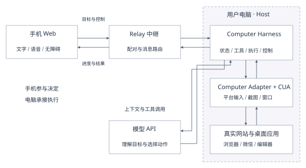
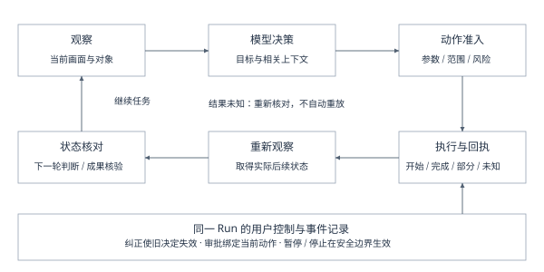

# Lightspeaker

## 手机协同桌面智能体：从开源操作能力到可靠任务执行

技术报告

申报方向：开源赋能的 AI 应用创新

融合特色：开源项目改进与生态贡献

版本日期：2026年10月21日

## 一、作品概述

为家中长辈准备一次出行，需要查车次、比较时间、读清票价，再把便于阅读的信息发到微信；了解一项公共服务，需要找到官方入口、辨别办理条件、整理材料和注意事项。这些需求围绕一件生活事务展开，却常被分散在网站、桌面应用和不同的操作界面中。使用者除了作出决定，还要承担查找入口、切换应用、理解反馈和反复核对的操作成本。

多模态模型为这一问题提供了新的可能：模型可以理解自然语言目标和界面截图，提出下一步动作；开源Computer-Use工具则能够提供截图、点击、输入与窗口操作。要将两者用于真实生活，仍需要把分散的动作组织成连续的任务。页面加载、弹窗、焦点转移和用户临时补充要求，都可能让上一轮正确的决定失去适用条件；操作返回成功，也可能只意味着输入已被系统接受，尚未形成用户期待的结果。

Lightspeaker是一套手机协同桌面智能体。用户在手机上通过文字或语音交代需求，由自己的电脑在真实网站与桌面应用中执行；手机展示任务进度、执行画面和结果，并提供补充要求、纠正、审批、暂停和停止的入口。大字、读屏支持、进展播报和个性化偏好共同组成用户参与任务的方式，使用户可以表达意图和掌握关键决定，而不必先理解窗口编号、坐标或工具参数。

系统的技术内核称为Computer Harness。Harness在这里指智能体的“运行支撑层”：它围绕一次任务，协调模型、工具、操作对象、执行记录和用户指令。模型负责理解与决策，CUA提供底层桌面能力，运行支撑层负责让决策在合适的对象和状态下执行，并把实际结果接回后续决策和用户交互。

本作品围绕三个相互联系的方向开展自主开发。首先，将手机与电脑组织为同一项任务的交互端和执行端，使语音、纠正与关键操作确认直接参与运行。其次，在开源CUA基础上实现跨应用状态管理、执行回执与重新观察、任务上下文和受控恢复，承接真实环境中的变化与失败。最后，以实际使用发现的问题形成独立复现、测试夹具和修复贡献，与上游维护者共同完善开源基础。

项目已围绕政务办事、就医准备、购物售后、出行票务、生活缴费与社区服务、通信与个人事务六类场景开展真实任务测试。报告选取有来源画面、运行记录和结果核验的案例，展示查询、整理、跨应用交付及用户介入如何在同一执行过程中协同。团队同时将Windows输入与资源生命周期等工程问题反馈到CUA和OpenClaw社区，形成从应用开发到生态共建的实践链条。

## 二、需求分析与总体方案

### 2.1 从操作界面回到生活目标

生活任务往往存在“目标简单、操作分散”的特点。用户想知道如何取消一次电话预约，实际需要辨别医院官方说明、找到预约与取消的不同条目，并核对证件和时限；用户想给家人发两班合适的火车，实际需要比较日期、车站、时刻和余票，再到另一应用完成交付。单个界面操作的难度并不一定高，困难来自条件在多个步骤之间持续有效。

对于老年用户、低数字素养用户和存在阅读障碍的使用者，这种分散还会带来额外负担：小字难读、状态提示不明显、不同应用交互不一致，以及出错后不知道如何返回。将每个页面都改成大按钮，无法独立解决跨应用过程中的理解与控制。因此，Lightspeaker把完整事务作为基本单位，允许用户说出目标，在必要时补充信息，并通过文字、声音或实际画面理解任务进行到了哪里。

真实任务同时包含不同程度的后果。阅读公开说明、整理草稿与向外发送消息，虽然可能只相差一次点击，用户需要保留的决定权却不同。任务执行应当在普通步骤中流畅推进，在发送、提交等关键步骤前清楚说明将发生的事情，并让用户能够确认或停止。风险控制由执行过程承接，避免用户为了完成普通查询而反复切回电脑控制台。

### 2.2 现有技术能够提供什么

Computer-Use研究表明，视觉理解、推理与界面动作能够形成通用的交互循环。OpenAI的《Computer-Using Agent》以感知、推理和行动解释这一过程，并讨论敏感操作的人类确认[1]。Magentic-One把复杂任务中的进度维护、错误恢复与执行协作作为系统设计重点[2]。Anthropic的《Building Effective Agents》强调清楚的工具接口、环境反馈和按需求组合能力[3]。这些工作为本项目提供了问题组织和系统设计参考。

Lightspeaker采用的执行基础是trycua社区的开源CUA项目[4]。它提供连接真实桌面的工具和驱动，与文献[1]中的同名模型属于不同项目。我们的工作重点位于模型与底层操作之间：围绕真实用户的一项任务，维护操作对象、执行事实和控制输入，使现有模型与开源动作能力能够组成持续使用的产品。

### 2.3 系统整体形态

系统由手机Web、Relay中继、电脑Host和Computer Harness组成。手机负责目标输入、状态查看和用户决定；Relay连接两端并转发受约束的任务消息；Host持有本机模型配置、桌面连接和受管浏览器状态，装配任务执行环境；Harness运行模型决策与桌面执行循环。电脑主动连接Relay，手机通过配对获得相应电脑任务的控制入口。

图1　Lightspeaker的交互、任务运行与桌面执行关系。手机操作与模型决策进入同一个任务控制层；底层桌面能力由CUA及其平台适配提供。

用户发起任务后，Host冻结本次目标、模块开关、预算与操作范围，再建立一次运行实例。模型读取当前界面和必要上下文，提出工具调用；运行支撑层检查调用并派发，记录回执，获取新画面，再继续模型决策。用户从手机提交的纠正、审批或停止命令也进入这次运行实例，而非另建一个与执行脱节的聊天过程。

这一部署方式保留了用户已有的电脑应用和账户环境。专用受管浏览器提供可复用的登录配置，微信、编辑器等原生应用通过桌面能力参与任务。手机不保存模型密钥或原生窗口句柄，也不需要把电脑画面变成可以精确点按的小型远程桌面。用户委托的是事务，系统在授权范围内组织应用操作。

### 2.4 交互与工程要求的对应

系统将用户需求转化为三项核心工程要求。第一，任务条件和状态应跨界面保留：更换应用后，日期、收件人和交付内容仍然有效。第二，执行结果应能核对：工具回执、界面变化和最终成果有对应记录，失败或不确定时不盲目重做。第三，用户参与应即时有效：补充条件后旧决定能够失效，审批针对当前操作，手机显示与实际运行保持一致。

产品交互据此形成闭环。目标输入说明“要做什么”，进展反馈说明“已经看到了什么、做到了哪里”，审批说明“下一步需要你决定什么”，纠正与暂停则允许用户重新控制方向。语音和无障碍是对这一闭环的另一种访问方式：看不清电脑画面的用户仍可以表达要求、了解状态并作出决定。

项目使用Windows与macOS共同的任务协议和运行逻辑，将输入、窗口及平台权限差异保留在底层适配。模型通过统一工具合同连接，避免更换厂商后重复实现任务控制。工程资源主要投入真实执行、失败核对和交互完善，基础模型、桌面驱动与通用Web组件通过现有生态获得。

## 三、AI与开源资源选型

### 3.1 多模态模型：负责目标理解与局部决策

Lightspeaker通过模型服务读取自然语言目标、当前截图和相关历史，并生成下一步工具调用。项目已接入GLM、Qwen、DeepSeek及火山方舟调用渠道。不同模型对图像、工具调用、结构化输出和历史续接的要求由Provider适配，运行支撑层使用统一的动作与任务协议。

选择模型API使团队能够将研发重点放在真实电脑任务的组织上，同时根据任务表现和延迟替换模型。模型可用动作来自本次运行的工具注册表。注册表同时提供工具描述、参数合同及执行入口，Provider据此构造请求，Runtime据此校验返回内容。这减少了提示词与执行端对工具可用性的理解差异。

结构化输出的实现结合各服务协议。Qwen采用统一调用数组承载单次或多次工具调用，将工具语义与输出信封分开组织，精确参数由本地校验；其他Provider按相应原生工具协议转换。工具说明不仅包含名称和类型，还解释输入是否依赖焦点、何时需要新观察、何种调用必须单独返回。模型差异收敛在请求与解析边界，任务状态和安全控制保持共用。

### 3.2 CUA：统一真实桌面的底层入口

CUA提供桌面观察、鼠标键盘输入和窗口操作等基础能力。采用这一开源基础，能够让浏览器与微信、记事本、办公软件进入同一桌面执行体系，避免为每类应用建立完全不同的执行器。其原生驱动也让团队能够在发现输入异常时追溯到实际操作系统机制。

Computer Harness通过适配层调用CUA，将截图、底层动作和执行结果映射为公共协议。适配层负责坐标转换、目标身份与焦点核对、引用有效性、输入路径选择和资源清理；上层Runtime负责一次任务中的调用顺序、事件、预算、审批与恢复。两者的分工使底层版本更新与运行策略调整能够分别验证。

视觉是通用操作基线。Windows的UIA、macOS的Accessibility和受管浏览器DOM可以补充控件名称、角色、边界及引用，提高结构明确时的定位精度。结构采集按配置启用，其可用性和耗时与视觉操作分开管理。普通截图与坐标动作继续承担通用交互，覆盖没有完整结构信息的应用界面。

### 3.3 通信、界面与工程基础

手机端采用React组织界面，Host与Relay通过Fastify和WebSocket提供连接与任务消息服务，Zod参与协议和工具参数校验。二维码配对、浏览器媒体接口与语音识别服务共同组成低门槛入口。语音输入使用服务端接入的识别能力，语音输出使用手机浏览器与系统的语音合成能力。

TypeScript公共类型、pnpm锁定依赖、Vitest与Node测试以及GitHub Actions支撑多包开发与回归。共享协议让手机、Host、模型适配和Computer适配围绕同一套任务状态协作；离线测试则能够构造取消、重复消息、部分失败等情形，保护真实使用环境。

| 资源层次 | 采用的基础 | 团队实现的工作 |
| --- | --- | --- |
| 理解与决策 | 云端多模态模型及语音识别服务 | Provider协议转换、工具投影、历史续接与调用校验接线 |
| 桌面操作 | 开源CUA SDK与原生驱动 | Computer适配、Surface状态、定位引用与运行结果映射 |
| 交互与连接 | React、Fastify、WebSocket及浏览器能力 | 手机控制面、配对、审批纠正、播报和个性化消费 |
| 任务运行 | 公共开发语言与校验、测试组件 | Runtime、统一工具、Context、Planning、Run Memory及恢复逻辑 |

表1　开源与服务资源的作用及自主开发边界。OpenClaw的贡献在第六章介绍，未列入本系统运行依赖。

## 四、系统设计与实现

### 4.1 将一次委托组织成持续运行

真实任务跨越多次模型请求和多个应用，但用户希望它始终是一件事。Computer Harness以一次Run承载目标、配置、执行预算、观察、动作、用户输入和终态。ComputerSession提供底层操作会话，在应用切换时维持连续连接；模型返回的调用则被转换为统一的执行意图，再进入运行控制。

统一工具系统允许模型在同一轮维护阶段计划、记录必要事实并提出允许组合的GUI动作。例如读取到关键条款后，可以同时写入Run Memory并继续查阅；阶段发生变化时，可以更新计划后执行下一步。终止等控制调用保持独占，以确保前序动作已有回执和新观察后再判断完成。

计划、记忆和上下文策略在Run启动时装配。关闭模块时，其工具、提示和状态投影一并移除；Computer后端不读取Planning或Memory的业务语义。共享的预算、Abort、事件和未知副作用处理始终由主循环承接。这使不同策略能够在同一运行基础上替换，也避免每增加一项能力就复制一套执行逻辑。

### 4.2 跨应用连续性：维护当前操作对象

GUI中的“同一个地方”并不稳定。浏览器翻页可能改变控件，原生应用打开保存对话框会改变输入目标，窗口最小化后先前坐标可能落到另一应用。仅在历史中保留一张截图或窗口标题，无法表达这些变化。系统因此维护Surface Registry，即本次任务正在使用的可交互界面登记表。

Surface可以对应桌面、原生窗口、浏览器标签或具有明确来源的局部界面。每个已登记对象具有任务内身份与版本；当前活动对象说明此刻动作针对谁，父子关系说明经确认的临时界面属于谁，浏览器页面沿袭关系则区分同一窗口中的标签和文档变化。原生窗口证据由平台适配产生，Registry负责状态转换，不直接扫描整个操作系统。

版本用于识别旧引用。当窗口、页面或控件的身份条件发生变化时，原先引用不再直接授权后续输入。模型需要从新观察取得当前候选，系统再核对实际对象与几何。这比依赖名称更加可靠：两个窗口可以同名，应用重新打开也可能复用相似标题，但旧坐标和旧控件不应跨越身份变化自动继续使用。

系统对两种切换采用不同语义。浏览器、微信和办公软件之间的平级切换，由模型在授权工具中列出候选并显式选择；保存对话框等临时界面，在平台提供明确归属和当前状态证据后作为子Surface进入，关闭后返回父对象。新出现的窗口先作为候选，只有与本任务操作有关且身份关系清楚时才进入使用状态，避免把无关浮层和装饰窗口都纳入任务控制。

窗口激活也需要后续观察。列出候选只说明对象存在，激活请求只说明系统尝试将它置前；在输入之前，适配层重新确认当前目标并获取画面。这样可以把“选择了微信”和“现在确实能在该微信窗口输入”区分开。用户手动切窗或系统弹出对话框时，后续输入仍要依据新状态，而不是沿用模型几轮前的假设。

全桌面模式保留另一种兼容路径。它持续观察真实前台，适用于独立弹窗和跨应用任务；可选DOM与UIA只补充当前获得授权的目标，不将整张桌面替换为某个浏览器的局部画面。指定窗口模式缩小截图和操作范围，有助于减少无关页面进入模型；跨应用权限则决定本次Run是否允许主动更换操作对象。采集范围与切换权限由用户选择，运行过程采用相应合同。

### 4.3 混合定位：把结构信息接回同一动作体系

视觉定位覆盖范围广，结构定位提供更明确的控件语义。Lightspeaker保留坐标click等基础工具，同时在启用结构采集时提供元素候选及元素操作。模型看到候选的描述、角色和引用，可以选择相应控件；执行适配将引用解析为当前实际对象，并与新鲜观察核对。

候选不是整棵界面树的原样转发。系统按目标和预算组织相关元素，保留来源与当前视图信息，减少与本轮动作无关的结构内容。网页DOM只来自Host管理、获得授权的浏览器目标；原生Accessibility信息由相应平台提供。两种来源在同一观察合同下进入上下文，避免把普通浏览器页面和受管页面误连。

坐标也始终绑定图像。Provider按模型所需坐标单位转换，Computer适配再处理窗口局部与桌面坐标之间的偏移和尺寸关系。显式元素操作执行前复查对象、位置与可交互条件；结构来源不可用时仍保留视觉操作。该设计使增强能力可以逐步接入，而不会要求所有业务页面都先完成DOM或Accessibility适配。

### 4.4 可靠执行：从调用回执走向界面核对

执行循环由观察、决策、准入、执行回执、新观察和状态核对构成。观察为当前决定提供画面与对象，准入确认工具和参数合法，执行产生事实记录，新观察则揭示应用实际形成了什么状态。下一轮模型同时读取动作记录和后续画面，再决定继续、调整、等待或交付。

图2　任务执行闭环。回执记录工具层发生的事实，重新观察提供界面结果；用户纠正、审批和停止通过同一Runtime参与推进。

运行事件将“准备执行”“已开始执行”和“得到结果”分开。事件经校验和持久化后再更新任务快照并通知界面，手机与轨迹读取相同事实。若工具在动作已开始后失去确定回执，系统将其视为可能产生副作用的情况，不因网络重试自动重新发送。只有明确零执行的拒绝和满足恢复条件的状态，才进入相应的恢复路径。

输入问题体现了这一区分的必要性。操作系统接受一组键盘事件，与目标应用完整接收一段文字存在时序差异；多行输入还可能触发提交。适配层区分普通输入与具有读回条件的文稿路径，Runtime保留部分执行和未知结果。用户看到的完成判断来自回执与后续画面，而不是把底层调用返回直接显示成“内容已经写好”。

任务交付也要求对应本次运行。发送消息、保存文件和创建内容应有本Run的执行动作与新观察支撑。历史中已经存在的相似消息可以帮助识别会话，却不能替代本次发送记录。查询类目标则根据来源覆盖和最终答复核验，不强求制造新的界面变更。不同目标沿用同一执行过程，但完成证据与用户所要求的结果相对应。

受控Action Batching服务于局部输入效率。当前批量执行限制在已激活的同一文本控件内的允许序列，Runtime仍逐动作校验、计入预算并记录回执与观察。导航、换控件、提交和不确定结果构成重新决策的边界。批量执行减少部分模型往返，同时保留逐项事实，避免把任意长动作序列交给开环执行。

### 4.5 上下文、规划与记忆：保留继续任务所需的信息

多轮任务会不断积累截图、工具回执和模型文字。直接无限累积既增加延迟，也可能让过期指导影响当前决定。Context Compiler把稳定的工具与协议说明、目标与约束、当前任务状态、相关记忆、近期历史和新观察分别组织，在预算内生成模型输入，并记录实际纳入的内容。

稳定部分优先保持顺序和形式一致，减少每轮无意义改写，为服务端提示缓存提供友好前缀；变化较大的截图、近期执行和控制输入放入动态部分。历史裁剪保留必要的调用与结果配对、用户纠正和Provider续接信息，使“留下最近几轮”不会破坏工具会话结构。上下文追踪使开发者能够检查某条反馈或记忆是否真的进入请求。

Planning记录任务做到哪里。模型通过统一工具维护阶段目标、进展、阻塞和阶段结果，系统将未完成事项投影到上下文。它适用于跨页面比较、整理和交付，而不要求为每次点击创建计划。一次应用切换后，模型仍可依据当前阶段继续，不必仅靠很长的聊天历史重新推断整项任务。

Run Memory记录继续完成任务需要记住什么。事实具有作用范围、保留类别和当前状态，区分稳定信息、当前任务信息与短期界面事实；更新与失效机制处理条件变化。系统依据任务关联和低成本检索信号组织召回，将适用事实与待核实内容分开投影。待核实事实用于提醒重新检查，不作为已确认结论直接延用。

召回先检查事实是否属于当前Run、会话和有效状态，再进行相关性排序。默认词面检索结合当前查询与事实内容，并保留精确标识匹配；配置语义检索时，在有界候选和调用预算内补充相似度。事实修订会使旧索引失效，已被替代的内容退出有效候选。适用性先于相似度，能够减少“找到了相关旧记忆，却在错误对象上使用”的情况。

计划与记忆由不同职责约束。阶段“正在比较两班车”属于进度；读到的出发站、查询日期或政策适用条件属于事实。用户更改条件后，后续上下文应反映新的约束，相关旧事实需要更新或重新核实。Replay则保存完整发生过程，为错误分析和结果追溯提供依据，不承担把全部历史永久塞回模型的工作。

### 4.6 非阻断监测与有界恢复

Monitor比较相邻观察和近期动作，组织无变化、重复尝试及模型状态描述等证据。它复用已有动作记录与观察评估，生成与当前卡点相关的提示，例如核对上一步是否生效、避免继续同区域微调、考虑替代入口。guidance模式将有界反馈加入下一轮上下文，shadow模式保留候选提示供分析。

监测不把像素变化直接解释成业务进展。网页轮播可能持续变化，表单关键值却没有改变；滚动或等待重复出现也可能是正常动作。提示需要与最近动作和局部目标一起解释，再由主模型结合新画面判断。系统因此保留监测证据、候选提示和实际上下文投影，便于分析提示是否被消费以及后续操作是否改变。

失败处理遵循结果边界。模型格式错误可在动作派发前给出有限反馈；请求重试受次数和时间预算约束；动作已执行但结果未知时先取得新状态，不重放原动作。暂停在安全边界停止推进，恢复继续同一个任务；Abort请求终止后续运行并清理资源，不回滚已经发生的应用操作。

### 4.7 风险控制与用户纠正

风险准入以本轮拟执行动作及其作用对象为中心。本地规则处理明确允许、必须确认和禁止的情况，将动作效果声明与目标、摘要和工具参数结合，覆盖发送、提交、敏感修改及输入中可能触发提交的边界。普通定位与可逆编辑不需要再为每一步增加一次模型判断，额外语义模型属于可选配置。

审批请求绑定到具体动作和当时的执行状态。用户看到操作内容与原因，选择批准或拒绝；执行前再核对对象与必要条件，避免等待期间发生切窗后仍在旧坐标输入。批准对应当前请求，不是永久放行同类操作。中文说明和语音消费沿用同一审批内容，使手机确认与真正等待执行的动作一致。

纠正通过Runtime收件箱进入当前任务。新条件被接收、记录并消费后，旧决定在后续派发边界失效，模型依据更新后的目标和新观察重新决策。这样用户说“日期不对”或“不要发给这个人”时，反馈不仅出现在聊天历史里，也会影响尚未执行的动作。事件保留接收与消费的区别，便于核查介入是否及时生效。

### 4.8 手机、语音和无障碍：同一任务的人本控制面

手机界面围绕新任务、当前任务和设置组织。用户可以选择初始目标与采集范围，发起任务后查看实际画面、结果和待确认内容；应用切换、纠正与审批都关联相同Run。状态刷新和重新连接根据任务事件恢复显示，避免手机暂时断开就把电脑任务误作已经结束。

语音输入把识别文本交给相同目标或纠正入口。语音输出消费任务开始、关键进展、等待审批、需要用户输入及结束等通知。进展来自模型对新观察和上一动作结果的描述，以里程碑或阻塞类别组织，程序检查来源绑定并去重。它利用正常决策轮中的状态解释，减少独立维护请求，也避免把每一次鼠标动作都机械播报。

无障碍界面提供清楚的控件名称、语义区域、焦点顺序与状态通知，调整完整句子的读屏组织；大字、高对比和减少动画满足不同阅读偏好。浏览器读屏和产品主动播报使用不同输出机制，用户可分别配置应用播报和读屏的使用方式。审批理由和结果文字同时保留在界面中，用户可以回听或用读屏查看。

个性化配置把用户自行编辑的表达与辅助偏好纳入新任务。允许的文字经Host校验，在Run开始时冻结，再按预算进入上下文；修改设置不会悄悄改变已运行任务的授权。偏好可以影响表达和呈现，但不会绕过风险规则。由此，手机、语音、审批和偏好共同服务同一目标：让Agent适应不同使用者，而不是要求使用者先适应Agent的工程接口。

## 五、真实场景验证与成果展示

### 5.1 以真实任务核验产品

项目使用真实官方网站和实际桌面应用开展测试。任务卡将自然语言需求与评分要求分开，启动前固定目标、起点、模型、允许副作用和交付形式；执行中保留截图、调用、回执、纠正与最终答复。复跑另存，失败和部分完成保留原记录，核验依据来自对应来源画面及最终成果。

评阅关注两类结果：执行是否在正确对象上发生，内容是否满足真实需求。系统结束状态用于描述运行过程，业务结论则逐项对照官网条款、车次页面、已交付文字或重新打开的文件。这样的区分在真实测试中尤为重要：一次查询可以顺利结束却选错政策范围，也可以获取到部分正确信息但尚未完成用户要求的交付。

### 5.2 六类生活场景覆盖

| 场景与任务 | 涉及的系统能力 | 实际结果与证据 |
| --- | --- | --- |
| 政务办事：查询上海敬老卡办理与代办要求 | 官网导航、材料整理、持续观察与失败保留 | 已有真实查询尝试；重复导航和接口限流导致未完成完整交付。依据六类任务记录G01及相应轨迹。 |
| 就医准备：查询华山医院电话预约、到院准备与取消方式 | 多页面阅读、阶段记录、来源核对与中文交付 | M02/D最终四项答复经来源观察605、615、639核对通过。另有协和就诊资料保存、重开与返回官网记录。 |
| 购物售后：查询大陆Apple实体店退货规则 | 政策渠道区分、记忆写入、条款覆盖 | S02/B正确交付期限、原店、材料及运营商协议例外；来源观察135、230可核对。 |
| 出行票务：携程比较车次并发送微信 | 浏览器与原生应用切换、用户纠正、审批和送达核对 | GLM04查到两班指定条件车次并向文件传输助手发送本Run新消息，保留来源、草稿、回执及02:05消息画面。 |
| 生活缴费与社区服务：核对示例燃气账单 | 官方价格读取、约束保持、计算与解释 | CP02使用明确标注的合成账单，已有价格和核心计算核对记录；个别说明仍存在适用范围问题。 |
| 通信与个人事务：查询指定版本日历的重复与提醒设置 | 版本识别、跨页面条件保持、纠正与监测 | CM02已读取部分手册内容，提醒及完整交付未完成；保留版本错选和重复导航记录。 |

表2　六类场景的真实任务覆盖。证据入口见附录，表内按对应运行分别描述。

### 5.3 案例一：为长辈比较车次并发送微信

该任务要求在携程查询2026年10月21日上海至雁荡山、10:00至12:00的直达车，选出两班，整理车站、时刻、历时、二等座价格与余票，再发到微信文件传输助手。它将动态查询、信息压缩和原生应用交付连接在一起，接近用户“帮我查清楚并发过去”的日常需求。

运行使用已有受管登录配置和已准备的表单状态，从真实携程页面读取信息。模型选择G7461与G7587，整理为一段简明中文，列出上海虹桥出发、到达雁荡山的时刻和历时，分别注明243元与240元及当时的余票情况，并加入查询日期和动态变化提醒。上述内容由查询时保存的来源画面核对，而非从预设答案注入。

查询后，模型列出并显式切换到微信，确认文件传输助手，输入整理文字并执行发送。运行保留输入、发送及后续观察，最终消息带有02:05时间标记，输入框已清空。核验将本Run新消息与聊天中旧有相似文字区分开，以实际新增交付确认完成。

任务中发生一次日期纠正。模型曾使用UTC日期，操作者通过Harness提醒核对电脑本地日期；纠正使旧决定失效，后续文字改用正确的本地查询日期。发送阶段由用户参与确认，该轮保留两次审批记录。纠正与确认都在同一任务内完成，查询结果、操作对象和交付内容没有因人工介入而丢失。

这条案例集中体现了运行支撑层的作用：模型决定查询和整理方式，CUA执行浏览器与微信动作，Harness维护当前对象、记录变更事实并处理纠正和审批。电脑链路保留原始轨迹与录像，可逐项对应来源、人工介入和最终交付。

> 【素材位A：正式双端Demo截图。手机目标、电脑携程来源、手机审批、微信新消息；待补。】

图3　从出行查询到微信交付的同一任务流程。

### 5.4 案例二：查清电话预约与就诊准备

就医准备任务面向不习惯使用复杂预约界面的长辈，要求说明华山医院电话预约方式、到院需准备的材料及取消要求。用户需要的是可以据此行动的说明，因此最终交付必须同时覆盖入口、准备和取消，不能只给出医院首页或一个二维码。

M02/D运行在实际官网逐步查找信息，并通过阶段计划记录当前进展。过程中曾进入二维码页和无关页面，随后继续找到包含电话预约、准备、确认及取消条文的正文。最终答复分别说明号码与语音流程、证件和短信、取消的渠道与时限。核验者对照该Run的三组来源观察逐项检查，四项核心内容均有官网依据。

交付将关键条件保留在具体事项旁。例如，电话预约按语音提示进行，到院确认需出示相应证件原件和预约短信，取消则需在就诊当日0点前通过原预约途径办理。答复同时提供官网预约挂号页来源，用户可以继续核对原文。报告采用测试时保存的页面与答复，保留该次查询的信息上下文。

该案例的意义在于把分散条文转成完整的就医准备说明。执行过程没有为用户预约、取消或拨打电话，最终交付是来源明确的中文信息。对手机和语音入口而言，这类任务能够将“自己找医院网站并逐层翻阅”转化为“说明需要了解什么，再核对整理结果”。

> 【素材位B：电话预约来源正文与对应最终答复，使用M02/D同一Run素材；待补。】

图4　就医准备任务的来源核对与信息交付。

### 5.5 案例三：辨别实体店售后的适用规则

购物售后任务设定为中国大陆Apple Store实体店购机后的退货咨询。页面都来自同一官方品牌，线上商店与实体店的期限起点、办理地点和条款仍可能不同。任务要求模型识别正确渠道，并同时查到普通退货材料和运营商协议相关例外。

S02/B运行从官网条款获取信息，最终答复覆盖购买后14日、原购买零售店、相应材料与包装，以及协议iPhone的相关说明。核验对照同Run来源观察135与230，确认核心内容有直接依据。过程中实际写入两条Run Memory，用于保存后续仍需使用的条款信息。

这一案例展示了真实信息任务中“找到官网”之后仍要解决的问题：明确政策对象、读全关键限制，并将适用条件带到最终答复。其他运行中出现的线上与实体店规则混用也被保留，用于完善来源与条件表达。案例选择依据完整核对后的交付，而非仅依据运行结束状态。

> 【素材位C：实体店政策来源与最终答复，使用S02/B同一Run素材；待补。】

图5　售后规则中的渠道条件与条款覆盖。

### 5.6 工程质量与迭代依据

项目使用自动化测试覆盖公共协议、事件状态重建、工具参数与组合、预算和取消、资源生命周期、模块开关、Host/Relay消息以及手机交互。当前取材版本的完整Vitest回归通过2594项；TypeScript构建与相关专项检查同时保留记录。CI按锁文件安装、构建并执行离线检查，在Windows与macOS矩阵中验证共享代码和平台构建。

验证分层对应不同问题。离线测试构造断线、重复提交和部分失败，真实API检查厂商工具协议，原生应用测试输入与焦点，业务运行核对实际来源和交付。Windows输入、全桌面与跨应用路径有本机记录，macOS由具备环境的成员维护平台适配与验证。各记录关联具体版本与初态，便于将错误定位到模型理解、工具协议、定位、输入或用户控制环节。

真实任务直接推动了工程完善。例如，新消息核对补充了本Run交付证据；输入中换行可能发送的情况进入动作说明与本地审批边界；页面反复点击促使Monitor复用已有证据提供局部提示；截图与结构信息的采集耗时则推动可选采集开关与默认路径收敛。任务记录因此既是成果材料，也是持续修复的依据。

## 六、创新性与开放价值

### 6.1 将真实任务的连续性建设为独立运行能力

Computer Harness将真实任务中反复出现的执行责任提取为独立系统能力。操作对象是否仍然有效、输入是否已经产生副作用、用户的新条件何时生效，都有程序状态和事件承接。模型可以继续负责灵活决策，任务控制则获得一致的依据。这一运行支撑层连接了基础模型的通用性与真实环境对连续执行的要求。

其开放价值在于把这套责任边界变成可复用合同。开发者能够替换Provider、Computer、上下文和Plan/Memory策略，同时共用预算、用户控制与副作用处理。任务案例可以变化，运行事实的含义保持稳定，为不同模型和策略的开发提供共同基础。

### 6.2 让用户以适合自己的方式参与智能体任务

Lightspeaker的人本交互目标是减少使用者理解软件界面和管理执行过程的负担。手机、语音、审批、纠正和偏好共用同一任务状态：用户可以用自然语言表达目的，通过适合自己的方式获得进展，并在重要时刻保留决定权。针对老年人、低数字素养和无障碍场景的设计由此进入核心任务流程。

这一方案把用户参与视为运行机制。交互端的改变会产生明确控制输入，运行端的变化会形成可显示、可读出的反馈，两者由同一任务关联。它使辅助交互能够随模型、应用和任务策略的变化继续复用，也为后续真实用户研究提供具体可检验的产品实现。

### 6.3 从实际输入异常到CUA上游修复

在开发Lightspeaker过程中，团队遇到现代Windows记事本的多行文本异常：模型输出文字正确，底层调用返回后，实际内容却可能在换行后丢失或出错。这个现象跨越模型、Harness、CUA和操作系统输入栈，单靠提高提示词约束无法定位。

团队将问题从完整业务任务中提取，形成独立复现，并准备WPF、WinUI3文本控件测试夹具。夹具由目标应用把真实文本状态写入文件，作为输入结果的核验值；比较保留空格和空行，只统一换行形式，并检查其他控件是否误收到输入。由此，测试从“驱动返回成功”推进到“目标应用究竟收到了什么”。

与上游维护者的进一步协作发现，固定等待后恢复原前台的时机，可能早于目标线程消费尾部输入。早期分批方案未能解决该问题，维护者最终采用目标队列sentinel与有界等待，在相应输入被处理后再恢复焦点。团队的复现、夹具与验证帮助缩小问题范围，最终队列修复由维护者继续完善并合并到CUA PR #4500[5]。

这次协作形成了一条完整的开源实践链：真实产品发现故障，最小复现排除上层业务因素，应用状态核验提供可靠证据，维护者结合原生机制定位，回归测试确认修复范围。开源代码使团队能够沿调用链追溯问题，团队也通过复现和测试把实际使用经验转化为上游可维护的资产。

后续文稿输入工作在团队PR #4836中继续推进，上游维护者在PR #5587保留团队两项原始提交，将带能力检查、读回验证和防止不确定输入重放的前台Document输入方案整合到主线，并进一步收敛写入范围、完善回退处理[6]。该PR于北京时间2026年10月21日合并，提交记录保留团队署名和原始提交来源。这项工作与前述输入队列修复分别处理文稿写入验证和焦点恢复时序问题，形成了持续的上游协作。

### 6.4 独立社区贡献与可复用成果

团队另外向OpenClaw贡献两项已合并修复：PR #126399处理任务结束后的Computer资源复用，PR #127177处理Windows设备反复审批[7][8]。它们分别涉及资源生命周期和用户授权体验，与团队长期关注的真实运行问题具有一致性。OpenClaw属于独立社区贡献项目，不是Lightspeaker的直接运行依赖。

项目开放的成果包括运行协议、工具与策略装配、桌面适配、手机控制、测试和使用材料。开发者可以复用默认实现，也可以在公共合同下替换模型与策略；使用者可以从真实生活任务出发贡献复现和案例；平台维护者可以通过最小测试定位输入和窗口问题。自主系统与上游协作共同构成作品的开放价值。

## 七、安全、隐私与合规

### 7.1 授权范围与数据流

任务在用户电脑和账户环境中执行，手机通过配对参与。Host持有模型凭据和受管浏览器配置，Relay承担连接与消息转发。浏览器登录状态保存在电脑专用配置中；模型请求按任务需要发送截图、目标、历史和启用的结构信息。窗口标题、页面内容和截图可能包含个人信息，采集范围与功能开关需要与实际任务相适应。

指定窗口模式缩小无关信息暴露，全桌面模式提供跨应用兼容性，两者由用户按需求选择。DOM仅连接受管授权目标，模型不能任意访问个人浏览器调试接口。个性化文字按允许字段校验并进入本次上下文，不改变桌面权限或审批规则。配对凭据、模型密钥、profile和私人轨迹不纳入公开仓库。

### 7.2 关键操作与可追溯执行

Runtime在工具派发前检查参数、权限、预算和风险准入，并将用户审批与具体请求关联。发送和提交等行为需要用户明确授权；暂停与停止保持可用，已发生副作用通过记录保留。部分执行或结果未知时，系统先重新观察，不自动重放，减少重复发送和重复修改的风险。

网页和文档内容作为任务数据处理，不能因页面内文字自动扩大工具权限。语义风险判断与模型生成的信息仍需结合程序边界和用户确认。公开Demo使用指定会话、测试资料和可公开内容，对无关账号与聊天作脱敏，保留原始记录供授权核验。

### 7.3 许可与第三方资源

Lightspeaker原创代码采用Apache-2.0。CUA SDK、平台binding、Web依赖和其他组件保留各自许可与署名；模型和语音识别服务遵守对应服务条款。第三方网站内容、品牌、账号和用户资料不因项目开源而转为项目资产。

项目通过LICENSE、THIRD_PARTY_NOTICES及独立第三方资源清单登记来源、版本、用途和许可。实际发行物还需对应原生driver、平台包和传递依赖，保留适用LICENSE与NOTICE。开源项目贡献按实际提交、审查与合并记录署名，团队与维护者的工作范围分别说明。

### 7.4 AI辅助开发与使用边界

团队在代码、测试、文档整理和问题分析中使用AI辅助，开发决策、结果核查、实机授权和提交材料由团队负责。AI生成内容通过源码审查、自动化测试和真实运行检查；案例事实依据实际来源与交付记录核对。

现阶段系统仍会受到模型理解、网站变化、网络服务与原生应用差异影响。手机无障碍和辅助交互已纳入实现，真实用户成效需要进一步试用；平台能力以对应系统的实机记录为依据。公开演示和任务材料集中展示已核验路径，运行失败与部分完成记录继续用于开发。

## 八、总结

Lightspeaker以真实生活事务为起点，将多模态模型、开源桌面能力与手机交互组织成完整智能体系统。Computer Harness为其中持续的任务执行提供运行支撑：维护应用变化中的操作对象，连接动作回执和新观察，处理用户纠正与关键确认，并保留失败和不确定结果的事实。

作品已形成手机Web、电脑Host和Relay协同的产品形态，围绕六类真实生活场景开展测试，完成了可核验的官方信息查询和跨应用交付案例。CUA输入问题的复现、测试与维护者协作，以及OpenClaw资源和审批修复，进一步将产品开发转化为对开源生态的实际贡献。

后续工作围绕现有能力完善展开：扩大普通用户、老年用户与读屏使用者的真实试用，积累稳定任务样例，开展固定版本和条件下的定量评测，并完善Windows与macOS的发行和使用流程。项目持续关注同一个目标：让用户能够以自然、可理解、可控制的方式，将真实电脑上的生活事务交给智能体完成。

## 九、附录

### 9.1 参考资料与开源贡献

[1] OpenAI. [Computer-Using Agent](https://openai.com/index/computer-using-agent/), 2025.

[2] Fourney A., et al. [Magentic-One: A Generalist Multi-Agent System for Solving Complex Tasks](https://www.microsoft.com/en-us/research/publication/magentic-one-a-generalist-multi-agent-system-for-solving-complex-tasks/), Microsoft Research, 2024.

[3] Anthropic. [Building Effective Agents](https://www.anthropic.com/engineering/building-effective-agents), 2024.

[4] trycua. [CUA开源仓库](https://github.com/trycua/cua).

[5] CUA [Issue #4477](https://github.com/trycua/cua/issues/4477)与[PR #4500](https://github.com/trycua/cua/pull/4500)，PR已合并。

[6] CUA [团队PR #4836](https://github.com/trycua/cua/pull/4836)与[维护者整合PR #5587](https://github.com/trycua/cua/pull/5587)，#5587已合并，状态核对日期2026年10月21日。

[7] OpenClaw [PR #126399](https://github.com/openclaw/openclaw/pull/126399)，已合并。

[8] OpenClaw [PR #127177](https://github.com/openclaw/openclaw/pull/127177)，已合并。

### 9.2 源码、工程与案例证据

项目入口：[Computer-Harness仓库](https://github.com/wszkxlllll/Computer-Harness)。当前产品说明见README，Windows使用流程见[开始使用](../getting-started.md)，自主协议与实现入口见[技术文档](../technical-guide.md)。

核心实现分布：任务循环与控制位于packages/runtime，公共合同位于packages/protocol，Surface与平台适配位于packages/computer-cua，上下文与记忆位于packages/context和packages/memory，手机、Host及Relay分别位于apps/web、apps/host和apps/relay。上述路径用于追踪第四章设计的具体实现。

工程证据：[CI运行39393854214](https://github.com/wszkxlllll/Computer-Harness/actions/runs/39393854214)；跨应用验收源码版本8872bfc；报告取材前文档分支基线d7d76bf。CI构建与离线检查、真实API及桌面业务记录分别保存。

真实任务总索引：[六类任务案例](../real-task-cases.md)与[逐次运行记录](../history/2026-10-20-release-convergence/life-business-evaluation-2026-10-15.md)。案例一为GLM04，Run尾号fc1c0fcb-999；案例二为M02/D，Run尾号b2f3f9fa-d17；案例三为S02/B，Run尾号f008ff81-ada。完整Run标识、来源观察、评分及本地产物位置均可由记录定位。

编辑器与社区补充材料：[医疗与社区运行记录](../history/2026-10-20-release-convergence/member-c-repair-twelve-runs-2026-10-18.md)，含文件重开画面、官网裁图和逐次结果。公开材料采用脱敏索引，原始私人画面由团队按授权保存。

### 9.3 提交附件

独立附件包括[第三方资源清单](./third-party-resources.md)、[项目许可](../../LICENSE)、[第三方声明](../../THIRD_PARTY_NOTICES.md)及正式Demo。提交材料、图像来源和待补素材统一登记在[材料入口](./README.md)。
